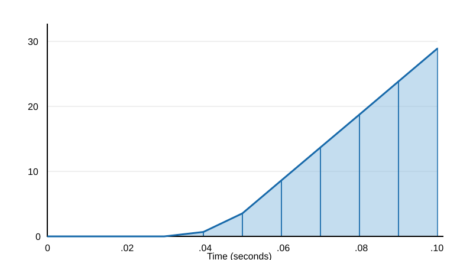

## Numerical Integration

- Left and right Riemann sum approximations
- The trapezoidal rule
- Simpson's rule
- Error bounds for numerical integration

---

## Where do function come from?

- Theory: $e^{ax}$ is a solution to the differential equation $\frac{dy}{dx}=ay$.
- Measurement: read the acceration data from a chip 1000 times a second.

Both are useful, but we need to be able to do calculus on both.

---

We integrate acceleration to get velocity.  We integrate velocity to get position.

$$
a(t)\longrightarrow v(t)\longrightarrow x(t)
$$

$$
v(t)-v(0)=\int_0^t a(s)\,ds
$$

$$
x(t)-x(0)=\int_0^t v(s)\,ds
$$

---

## Rocketry Data

| $t$ (s) | .01 | .02 | .03 | .04 | .05 |
|:--|--:|--:|--:|--:|--:|
| $a(t)$ ($\mathrm{m/s^2}$) | 0.00 | 0.00 | 0.00 | 0.68 | 3.54 |

| $t$ (s) | .06 | .07 | .08 | .09 | .10 |
|:--|--:|--:|--:|--:|--:|
| $a(t)$ ($\mathrm{m/s^2}$) | 8.62 | 13.69 | 18.77 | 23.84 | 28.92 |

Assume $v(0)=x(0)=0$.

## Rocketry: Acceleration Data

<svg viewBox="0 0 800 440" width="100%" xmlns="http://www.w3.org/2000/svg">
<rect width="800" height="440" fill="white"/>
<g stroke="#ddd">
<path d="M80 290H740 M80 180H740 M80 70H740"/>
</g>
<path d="M80 40V400H750" stroke="black" stroke-width="2" fill="none"/>
<g font-family="Arial" font-size="16" fill="black">
<text x="60" y="406">0</text>
<text x="47" y="296">10</text>
<text x="47" y="186">20</text>
<text x="47" y="76">30</text>
<text x="76" y="425">0</text>
<text x="204" y="425">.02</text>
<text x="336" y="425">.04</text>
<text x="468" y="425">.06</text>
<text x="600" y="425">.08</text>
<text x="728" y="425">.10</text>
<text x="350" y="439">Time (seconds)</text>
</g>
<polyline points="80,400 146,400 212,400 278,400 344,392.52 410,361.06 476,305.18 542,249.41 608,193.67 674,137.76 740,81.88"
 fill="none" stroke="#1769aa" stroke-width="3"/>
<g fill="#1769aa">
<circle cx="80" cy="400" r="4"/>
<circle cx="146" cy="400" r="4"/>
<circle cx="212" cy="400" r="4"/>
<circle cx="278" cy="400" r="4"/>
<circle cx="344" cy="392.52" r="4"/>
<circle cx="410" cy="361.06" r="4"/>
<circle cx="476" cy="305.18" r="4"/>
<circle cx="542" cy="249.41" r="4"/>
<circle cx="608" cy="193.67" r="4"/>
<circle cx="674" cy="137.76" r="4"/>
<circle cx="740" cy="81.88" r="4"/>
</g>
</svg>

## Notation for numerical integration

Divide $[a,b]$ into $n$ subintervals of equal width:

$\Delta x=\dfrac{b-a}{n}$

The partition points are

$x_i=a+i\Delta x,\quad i=0,1,\ldots,n.$

For the acceleration example, the interval is $[0,.1]$, $n=10$, and $\Delta t=.01$ second.

## Left endpoint rule

The **Left Endpoint Rule** approximates the integral using the function value at the left endpoint of each subinterval.

$L_n=\Delta x[f(x_0)+f(x_1)+\cdots+f(x_{n-1})]$

. . . 

For the rocketry data, using $a(0)=0$:

$L_{10}=.01[a(0)+a(.01)+\cdots+a(.09)]$

$L_{10}=.01[0+0+0+0+.68+3.54$

$\qquad\qquad +8.62+13.69+18.77+23.84]$

$L_{10}=.6914\ \mathrm{m/s}$

---

## Rocketry: Left Endpoint Rule

<svg viewBox="0 0 800 440" width="100%" xmlns="http://www.w3.org/2000/svg">
<rect width="800" height="440" fill="white"/>
<g stroke="#ddd">
<path d="M80 290H740 M80 180H740 M80 70H740"/>
</g>
<g fill="#8bbce0" fill-opacity=".5" stroke="#1769aa" stroke-width="1.5">
<rect x="344" y="392.52" width="66" height="7.48"/>
<rect x="410" y="361.06" width="66" height="38.94"/>
<rect x="476" y="305.18" width="66" height="94.82"/>
<rect x="542" y="249.41" width="66" height="150.59"/>
<rect x="608" y="193.67" width="66" height="206.33"/>
<rect x="674" y="137.76" width="66" height="262.24"/>
</g>
<path d="M80 40V400H750" stroke="black" stroke-width="2" fill="none"/>
<g font-family="Arial" font-size="16" fill="black">
<text x="60" y="406">0</text>
<text x="47" y="296">10</text>
<text x="47" y="186">20</text>
<text x="47" y="76">30</text>
<text x="76" y="425">0</text>
<text x="204" y="425">.02</text>
<text x="336" y="425">.04</text>
<text x="468" y="425">.06</text>
<text x="600" y="425">.08</text>
<text x="728" y="425">.10</text>
<text x="350" y="439">Time (seconds)</text>
</g>
<polyline points="80,400 146,400 212,400 278,400 344,392.52 410,361.06 476,305.18 542,249.41 608,193.67 674,137.76 740,81.88"
 fill="none" stroke="#1769aa" stroke-width="3"/>
</svg>

---

## Right endpoint rule

The **Right Endpoint Rule** approximates the integral using the function value at the right endpoint of each subinterval.

. . . 

$R_n=\Delta x[f(x_1)+f(x_2)+\cdots+f(x_n)]$

For the rocketry data:

$R_{10}=.01[a(.01)+a(.02)+\cdots+a(.10)]$

$R_{10}=.01[0+0+0+.68+3.54+8.62$

$\qquad\qquad +13.69+18.77+23.84+28.92]$

$R_{10}=.9806\ \mathrm{m/s}$

---

## Rocketry: Right Endpoint Rule

<svg viewBox="0 0 800 440" width="100%" xmlns="http://www.w3.org/2000/svg">
<rect width="800" height="440" fill="white"/>
<g stroke="#ddd">
<path d="M80 290H740 M80 180H740 M80 70H740"/>
</g>
<g fill="#8bbce0" fill-opacity=".5" stroke="#1769aa" stroke-width="1.5">
<rect x="278" y="392.52" width="66" height="7.48"/>
<rect x="344" y="361.06" width="66" height="38.94"/>
<rect x="410" y="305.18" width="66" height="94.82"/>
<rect x="476" y="249.41" width="66" height="150.59"/>
<rect x="542" y="193.67" width="66" height="206.33"/>
<rect x="608" y="137.76" width="66" height="262.24"/>
<rect x="674" y="81.88" width="66" height="318.12"/>
</g>
<path d="M80 40V400H750" stroke="black" stroke-width="2" fill="none"/>
<g font-family="Arial" font-size="16" fill="black">
<text x="60" y="406">0</text>
<text x="47" y="296">10</text>
<text x="47" y="186">20</text>
<text x="47" y="76">30</text>
<text x="76" y="425">0</text>
<text x="204" y="425">.02</text>
<text x="336" y="425">.04</text>
<text x="468" y="425">.06</text>
<text x="600" y="425">.08</text>
<text x="728" y="425">.10</text>
<text x="350" y="439">Time (seconds)</text>
</g>
<polyline points="80,400 146,400 212,400 278,400 344,392.52 410,361.06 476,305.18 542,249.41 608,193.67 674,137.76 740,81.88"
 fill="none" stroke="#1769aa" stroke-width="3"/>
</svg>

---

## Error Analysis

For an **increasing function**:

- The **Left Endpoint Rule** gives an underestimate.
- The **Right Endpoint Rule** gives an overestimate.

## The Trapezoidal Rule

The **Trapezoidal Rule** approximates the integral by using trapezoids instead of rectangles.

$T_n=\dfrac{\Delta x}{2}[f(x_0)+2f(x_1)+\cdots+2f(x_{n-1})+f(x_n)]$

. . . 

For the rocketry data:

$T_{10}=.8360\ \mathrm{m/s}$

Thus, the approximate velocity at $t=.1$ second is

$v(.1)\approx .8360\ \mathrm{m/s}$.

---

## Rocketry: Trapezoidal Rule

{width="90%"}

---

## Error Estimate Formulas

**Left Endpoint Rule Error Bound:**
Suppose $|f'(x)|\leq K$ for all $x\in[a,b]$.

$\displaystyle |E_L|\leq \frac{K(b-a)^2}{2n}$

**Right Endpoint Rule Error Bound:**
Suppose $|f'(x)|\leq K$ for all $x\in[a,b]$.

$\displaystyle |E_R|\leq \frac{K(b-a)^2}{2n}$

**Trapezoidal Rule Error Bound:**
Suppose $|f''(x)|\leq K$ for all $x\in[a,b]$.

$\displaystyle |E_T|\leq \frac{K(b-a)^3}{12n^2}$

## Error Bound:  Endpoint Rules

For the acceleration data, $0\leq t\leq .10$ and $n=10$.

Estimate the maximum first derivative using the data:

$K\approx \max\left|\dfrac{\Delta a}{\Delta t}\right|=\dfrac{5.08}{.01}=508$

Assuming $|a'(t)|\leq 508$, the Left Endpoint Rule error satisfies

$\displaystyle |E_L|\leq \frac{K_1(b-a)^2}{2n}$

Substituting,

$\displaystyle |E_L|\leq \frac{508(.10)^2}{2(10)}$

$\displaystyle \boxed{|E_L|\leq .254\ \mathrm{m/s}}$

Our approximation was $L_{10}=.6914\ \mathrm{m/s}$.  Since $E_R$ uses the same formuala, $R_{10}=.9806\ \mathrm{m/s}$.

---

## What if We Measure 10 Times More Frequently?

Keep the same time interval $[0,.10]$ and derivative bound $K=508$.

Increasing the sampling frequency by a factor of $10$ gives:

- $n=100$ instead of $n=10$.
- $\Delta t=.001$ instead of $\Delta t=.01$.

The Left and Right Endpoint Rule error bounds are

$\displaystyle |E_L|,\ |E_R|\leq\frac{K(b-a)^2}{2n}$

Substituting $n=100$,

$\displaystyle |E_L|,\ |E_R|\leq\frac{508(.10)^2}{2(100)}$

$\displaystyle \boxed{|E_L|,\ |E_R|\leq .0254\ \mathrm{m/s}}$

Compare with the original error bound:

$\displaystyle \frac{.254}{.0254}=10$

---

## Error Bound: Trapezoidal Rule

Assuming acceleration is sufficiently smooth and approximately quadratic, estimate the second derivative using consecutive measurements:

$\displaystyle a''(t)\approx\frac{a(t+.01)-2a(t)+a(t-.01)}{(.01)^2}$

For example, using $t=.05$,

$\displaystyle a''(.05)\approx\frac{8.62-2(3.54)+.68}{(.01)^2}=22{,}200$

The largest observed second difference gives $K\approx22{,}200$.

Assuming $|a''(t)|\leq22{,}200$,

$\displaystyle |E_T|\leq\frac{K(b-a)^3}{12n^2}$

$\displaystyle |E_T|\leq\frac{22{,}200(.10)^3}{12(10)^2}$

$\displaystyle \boxed{|E_T|\leq .0185\ \mathrm{m/s}}$

Our approximation was $T_{10}=.8360\ \mathrm{m/s}$.

---

## What if We Measure 10 Times More Frequently?

Keep the same time interval $[0,.10]$ and derivative bound $K=22{,}200$.

Increasing the sampling frequency by a factor of $10$ gives:

- $n=100$ instead of $n=10$.
- $\Delta t=.001$ instead of $\Delta t=.01$.

The Trapezoidal Rule error bound is

$\displaystyle |E_T|\leq\frac{K(b-a)^3}{12n^2}$

Substituting $n=100$,

$\displaystyle |E_T|\leq\frac{22{,}200(.10)^3}{12(100)^2}$

$\displaystyle \boxed{|E_T|\leq .000185\ \mathrm{m/s}}$

Compare with the original estimate:

$\displaystyle \frac{.0185}{.000185}=100$

---

## Faster Sampling: LSM303AGR Accelerometer

The LSM303AGR is a consumer grade accerometer that can measure accelleration at 1,344 sample per second.

For the same $.10$ second interval:

| | Original | LSM303AGR |
|:--|--:|--:|
| Sampling rate | 100 Hz | 1,344 Hz |
| $\Delta t$ | .010 s | .000744 s |
| Subintervals | 10 | $\approx 134$ |

Recall the Trapezoidal Rule error bound:

$\displaystyle |E_T|\leq\frac{K(b-a)^3}{12n^2}$

Using $K=22{,}200$ and $n=134$,

$\displaystyle |E_T|\leq\frac{22{,}200(.10)^3}{12(134)^2}$

$\displaystyle \boxed{|E_T|\leq .000103\ \mathrm{m/s}}$

**The estimated error bound is approximately 180 times smaller!**

---

## Why the Trapezoidal Rule is an average

On $[x_{i-1},x_i]$, the area of the trapezoid is

$\dfrac{\Delta x}{2}[f(x_{i-1})+f(x_i)].$

Adding these trapezoidal areas gives

$T_n=\dfrac{L_n+R_n}{2}.$

For our example,

$T_4=\dfrac{11+19}{2}=15\ \mathrm{m/s}.$

Averaging the left and right sums reduces the error in this example but does not necessarily eliminate it.

## Absolute and relative error

If $A$ is the actual value and $B$ is an approximation, then

$\text{Absolute error}=|A-B|.$

The relative error is

$\text{Relative error}=\dfrac{|A-B|}{|A|},\quad A\ne0.$

To express relative error as a percentage, multiply by $100\%$.

For $T_4=15$ and exact value $44/3$,

$\text{Absolute error}=\left|\frac{44}{3}-15\right|=\frac13\ \mathrm{m/s}.$

## Falling Object with Air Resistance

Suppose an object falls from rest under gravity with quadratic air resistance.

Newton's Second Law gives

$m\dfrac{dv}{dt}=mg-cv^2$

where

- $v(t)$ is the downward velocity.
- $mg$ is the gravitational force.
- $cv^2$ is the force of air resistance.

For our example, take $g=10$ and $c/m=0.1$.

Then

$\displaystyle \boxed{\frac{dv}{dt}=10-0.1v^2}$

Assume $v(0)=0$.

**What is the velocity after one second?**

---

## From a Differential Equation to an Integral

Our differential equation is

$\dfrac{dv}{dt}=10-0.1v^2.$

Integrating from $0$ to $t$,

$\displaystyle v(t)-v(0)=\int_0^t(10-0.1v(s)^2)\,ds$

Since $v(0)=0$,

$\displaystyle v(t)=\int_0^t(10-0.1v(s)^2)\,ds$

We want to approximate

$\displaystyle v(1)=\int_0^1(10-0.1v(s)^2)\,ds$

The difficulty is that we do not know $v(t)$.

We will use numerical integration to approximate it.

---

## Applying the Trapezoidal Rule

Divide $[0,1]$ into $n$ subintervals of width

$\Delta t=\dfrac{1}{n}.$

On each subinterval,

$\displaystyle v_{i+1}\approx v_i+\int_{t_i}^{t_{i+1}}(10-0.1v^2)\,dt$

Using the Trapezoidal Rule,

$\displaystyle v_{i+1}=v_i+\frac{\Delta t}{2}[(10-0.1v_i^2)+(10-0.1v_{i+1}^2)]$

Simplifying,

$\displaystyle v_{i+1}=v_i+10\Delta t-\frac{.1\Delta t}{2}(v_i^2+v_{i+1}^2)$

Notice that $v_{i+1}$ appears on both sides.

**We must solve a quadratic equation at each step.**

---

## Quadratic Drag: 10 Subintervals

For $n=10$,

$\Delta t=.1.$

Our formula becomes

$\displaystyle v_{i+1}=v_i+1-.005(v_i^2+v_{i+1}^2)$

Rearranging,

$\displaystyle .005v_{i+1}^2+v_{i+1}=v_i+1-.005v_i^2$

Starting with $v_0=0$,

$\displaystyle .005v_1^2+v_1=1$

Using the quadratic formula and taking the positive root,

$\displaystyle v_1=\frac{-1+\sqrt{1.02}}{.01}$

$\displaystyle v_1\approx .995049\ \mathrm{m/s}$

Repeating this process gives the velocity at each time.

---

## Quadratic Drag: Numerical Results

Using $n=10$ and $\Delta t=.1$:

| $t$ (s) | $v(t)$ (m/s) |
|:--|--:|
| 0.0 | 0.000000 |
| 0.1 | 0.995049 |
| 0.2 | 1.970681 |
| 0.3 | 2.908953 |
| 0.4 | 3.794646 |
| 0.5 | 4.616107 |
| 0.6 | 5.365616 |
| 0.7 | 6.039301 |
| 0.8 | 6.636706 |
| 0.9 | 7.160139 |
| 1.0 | 7.613940 |

Thus,

$\displaystyle \boxed{v(1)\approx7.613940\ \mathrm{m/s}}$

Notice that the velocity increases, but the acceleration decreases as air resistance grows.

---

## Quadratic Drag: 100 Subintervals

Now increase the number of subintervals by a factor of $10$.

| | First calculation | Second calculation |
|:--|--:|--:|
| Interval | $[0,1]$ | $[0,1]$ |
| $n$ | 10 | 100 |
| $\Delta t$ | .1 | .01 |

Our Trapezoidal Rule equation becomes

$\displaystyle v_{i+1}=v_i+.1-.0005(v_i^2+v_{i+1}^2)$

Starting with $v_0=0$, repeat the calculation 100 times.

The resulting approximation is

$\displaystyle \boxed{v(1)\approx7.615922\ \mathrm{m/s}}$

**How much more accurate is this approximation?**

---

## Quadratic Drag: Exact Solution

The differential equation

$\displaystyle \frac{dv}{dt}=10-0.1v^2$

with $v(0)=0$ has the exact solution

$v(t)=10\tanh(t).$

Therefore,

$\displaystyle v(1)=10\tanh(1)$

$\displaystyle \boxed{v(1)\approx7.615942\ \mathrm{m/s}}$

Compare our approximations:

| Method | Velocity (m/s) |
|:--|--:|
| Trapezoidal, $n=10$ | 7.613940 |
| Trapezoidal, $n=100$ | 7.615922 |
| Exact | 7.615942 |

Both numerical approximations underestimate the exact velocity.

---

## Quadratic Drag: Error Analysis

The absolute error is

$\text{Error}=|\text{Exact Value}-\text{Approximation}|$

For $n=10$,

$|E_{10}|\approx .00200135\ \mathrm{m/s}$

For $n=100$,

$|E_{100}|\approx .00001993\ \mathrm{m/s}$

Compare the errors:

$\displaystyle \frac{|E_{10}|}{|E_{100}|}\approx100.4$

**Increasing the number of subintervals by a factor of 10 reduces the error by approximately a factor of 100.**

This illustrates second-order convergence of the Trapezoidal Rule for this differential equation.

---

## Terminal Velocity

Recall the equation

$\displaystyle \frac{dv}{dt}=10-0.1v^2.$

As the object speeds up, air resistance increases.

Eventually, gravitational force and drag balance, so acceleration approaches zero:

$0=10-0.1v^2$

Solving,

$v^2=100$

$\displaystyle \boxed{v_{\mathrm{terminal}}=10\ \mathrm{m/s}}$

The velocity approaches $10\ \mathrm{m/s}$ but never exceeds it.

---
