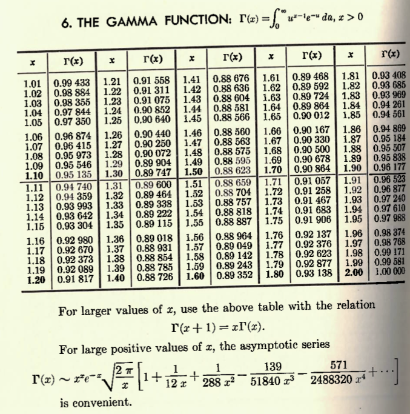

## Sequences

Class Session Goals:

- Find a formula for the general term of a sequence.
- Calculate the limit of a sequence, if it exists.
- Determine whether a sequence converges or diverges.
- Use boundedness and monotonicity to establish convergence.

---

## Taylor's Theorem and Motivation

Can we approximate a function using polynomials?

If $f$ has continuous derivatives through order $n+1$ on an interval containing $a$ and $x$, Taylor's Theorem gives

$\displaystyle f(x)=\sum_{k=0}^{n}\frac{f^{(k)}(a)}{k!}(x-a)^k+R_n(x)$,

where $\displaystyle R_n(x)=\frac{f^{(n+1)}(c)}{(n+1)!}(x-a)^{n+1}$ for some $c$ between $a$ and $x$.

---

## Gamma Function

{width="85%" fig-align="center"}

---

## Infinite Series

As $n$ increases, the Taylor polynomials form a **sequence**.

If $R_n(x)\to0$, then

$\displaystyle f(x)=\sum_{k=0}^{\infty}\frac{f^{(k)}(a)}{k!}(x-a)^k.$

When does this **infinite series** converge, and when does it equal $f(x)$?

---

## What is a Sequence?

An **infinite sequence** is an ordered list of numbers:

$a_1,a_2,a_3,\ldots,a_n,\ldots$

Each number $a_n$ is a **term**. The integer $n$ is the **index**.

We write $\{a_n\}_{n=1}^{\infty}$, or simply $\{a_n\}$.

For example, $\{2^n\}_{n=1}^{\infty}=\{2,4,8,16,\ldots\}$.

---

## Two Ways to Define a Sequence

1.**Explicit formula** gives a term directly from its index as a function of the index:

$a_n=2^n,\quad n\ge 1.$

2. **Recurrence relation** gives a term using preceding terms:

$b_1=2,\quad b_n=2b_{n-1},\quad n\ge 2.$

Here $\{a_n\}=\{b_n\}$ since each term is the same.

---

## Arithmetic Sequences

An **arithmetic sequence** has a constant difference between consecutive terms.

$3,7,11,15,19,\ldots$

. . .

$a_1=3,\quad a_n=a_{n-1}+4,\quad n\ge 2.$

$a_n=3+4(n-1)=4n-1.$

In general, $a_n=a_1+(n-1)d$, where $d$ is the common difference.

---

## Geometric Sequences

A **geometric sequence** has a constant ratio between consecutive nonzero terms.

$2,-\frac{2}{3},\frac{2}{9},-\frac{2}{27},\frac{2}{81},\ldots$

. . .

$a_1=2,\quad a_n=-\frac{1}{3}a_{n-1},\quad n\ge 2.$

$a_n=2\left(-\frac{1}{3}\right)^{n-1}.$

In general, $a_n=a_1r^{n-1}$, where $r$ is the common ratio.

---

## Finding an Explicit Formula

Find a formula for the $n$th term, starting with $n=1$:

$-\frac{1}{2},\frac{2}{3},-\frac{3}{4},\frac{4}{5},-\frac{5}{6},\ldots$

. . .

The numerators are $n$, and the denominators are $n+1$.

The factor $(-1)^n$ gives a negative sign when $n$ is odd.

$a_n=\dfrac{(-1)^n n}{n+1}.$

---

## Another Explicit Formula

Find a formula for the $n$th term, starting with $n=1$:

$\frac{3}{4},\frac{9}{7},\frac{27}{10},\frac{81}{13},\frac{243}{16},\ldots$

. . .

The numerators form a geometric sequence: $3^n$.

The denominators form an arithmetic sequence: $4+3(n-1)=3n+1$.

$a_n=\dfrac{3^n}{3n+1}.$

---

## From a Recurrence to a Formula

Suppose $a_1=\frac{1}{2}$ and $a_n=a_{n-1}+\left(\frac{1}{2}\right)^n$ for $n\ge 2$.

Write the first four terms and look for a formula.

. . .

$a_1=\frac{1}{2},\quad a_2=\frac{3}{4},\quad a_3=\frac{7}{8},\quad a_4=\frac{15}{16}.$

$a_n=\dfrac{2^n-1}{2^n}=1-\dfrac{1}{2^n}.$

Substitution verifies the initial value and recurrence.

---

## Graphing a Sequence

We graph the points $(n,a_n)$ with $n$ on the horizonal axis and the value of the sequence on the vertical axis. 

For $a_n=1-\dfrac{1}{2^n}$:

| $n$ | 1 | 2 | 3 | 4 | 5 |
|:--|--:|--:|--:|--:|--:|
| $a_n$ | .5 | .75 | .875 | .9375 | .96875 |

---

## Behavior of Sequences

<svg role="img" aria-labelledby="converging-title converging-desc" xmlns:xlink="http://www.w3.org/1999/xlink" width="100%" viewBox="0 0 601.3875 231.006" xmlns="http://www.w3.org/2000/svg" version="1.1"><title id="converging-title">A sequence approaching one</title><desc id="converging-desc">Discrete points for a_n = 1 minus 1 divided by 2 to the n, for n from 1 to 10. The points increase toward the dashed horizontal line at one.</desc>
 <metadata>
  <rdf:RDF xmlns:dc="http://purl.org/dc/elements/1.1/" xmlns:cc="http://creativecommons.org/ns#" xmlns:rdf="http://www.w3.org/1999/02/22-rdf-syntax-ns#">
   <cc:Work>
    <dc:type rdf:resource="http://purl.org/dc/dcmitype/StillImage"/>
    <dc:date>2026-10-20T19:33:58.151918</dc:date>
    <dc:format>image/svg+xml</dc:format>
    <dc:creator>
     <cc:Agent>
      <dc:title>Matplotlib v3.10.8, https://matplotlib.org/</dc:title>
     </cc:Agent>
    </dc:creator>
   </cc:Work>
  </rdf:RDF>
 </metadata>
 <defs>
  
 </defs>
 <g id="figure_1">
  <g id="patch_1">
   <path d="M -0 231.006 
L 601.3875 231.006 
L 601.3875 0 
L -0 0 
z
" style="fill: #fdf6e3"/>
  </g>
  <g id="axes_1">
   <g id="patch_2">
    <path d="M 58.5075 181.836 
L 594.1875 181.836 
L 594.1875 7.2 
L 58.5075 7.2 
z
" style="fill: #fdf6e3"/>
   </g>
   <g id="matplotlib.axis_1">
    <g id="xtick_1">
     <g id="line2d_1">
      <path d="M 58.5075 181.836 
L 58.5075 7.2 
" clip-path="url(#p4e405a8059)" style="fill: none; stroke: #b0b0b0; stroke-opacity: 0.2; stroke-width: 0.8; stroke-linecap: square"/>
     </g>
     <g id="line2d_2">
      <defs>
       <path id="m08167102fe" d="M 0 0 
L 0 3.5 
" style="stroke: #586e75; stroke-width: 0.8"/>
      </defs>
      <g>
       <use xlink:href="#m08167102fe" x="58.5075" y="181.836" style="fill: #586e75; stroke: #586e75; stroke-width: 0.8"/>
      </g>
     </g>
     <g id="text_1">
      <text style="font-size: 15px; font-family: 'DejaVu Sans'; text-anchor: middle; fill: #586e75" x="58.5075" y="200.233656" transform="rotate(-0 58.5075 200.233656)">0</text>
     </g>
    </g>
    <g id="xtick_2">
     <g id="line2d_3">
      <path d="M 159.579198 181.836 
L 159.579198 7.2 
" clip-path="url(#p4e405a8059)" style="fill: none; stroke: #b0b0b0; stroke-opacity: 0.2; stroke-width: 0.8; stroke-linecap: square"/>
     </g>
     <g id="line2d_4">
      <g>
       <use xlink:href="#m08167102fe" x="159.579198" y="181.836" style="fill: #586e75; stroke: #586e75; stroke-width: 0.8"/>
      </g>
     </g>
     <g id="text_2">
      <text style="font-size: 15px; font-family: 'DejaVu Sans'; text-anchor: middle; fill: #586e75" x="159.579198" y="200.233656" transform="rotate(-0 159.579198 200.233656)">2</text>
     </g>
    </g>
    <g id="xtick_3">
     <g id="line2d_5">
      <path d="M 260.650896 181.836 
L 260.650896 7.2 
" clip-path="url(#p4e405a8059)" style="fill: none; stroke: #b0b0b0; stroke-opacity: 0.2; stroke-width: 0.8; stroke-linecap: square"/>
     </g>
     <g id="line2d_6">
      <g>
       <use xlink:href="#m08167102fe" x="260.650896" y="181.836" style="fill: #586e75; stroke: #586e75; stroke-width: 0.8"/>
      </g>
     </g>
     <g id="text_3">
      <text style="font-size: 15px; font-family: 'DejaVu Sans'; text-anchor: middle; fill: #586e75" x="260.650896" y="200.233656" transform="rotate(-0 260.650896 200.233656)">4</text>
     </g>
    </g>
    <g id="xtick_4">
     <g id="line2d_7">
      <path d="M 361.722594 181.836 
L 361.722594 7.2 
" clip-path="url(#p4e405a8059)" style="fill: none; stroke: #b0b0b0; stroke-opacity: 0.2; stroke-width: 0.8; stroke-linecap: square"/>
     </g>
     <g id="line2d_8">
      <g>
       <use xlink:href="#m08167102fe" x="361.722594" y="181.836" style="fill: #586e75; stroke: #586e75; stroke-width: 0.8"/>
      </g>
     </g>
     <g id="text_4">
      <text style="font-size: 15px; font-family: 'DejaVu Sans'; text-anchor: middle; fill: #586e75" x="361.722594" y="200.233656" transform="rotate(-0 361.722594 200.233656)">6</text>
     </g>
    </g>
    <g id="xtick_5">
     <g id="line2d_9">
      <path d="M 462.794292 181.836 
L 462.794292 7.2 
" clip-path="url(#p4e405a8059)" style="fill: none; stroke: #b0b0b0; stroke-opacity: 0.2; stroke-width: 0.8; stroke-linecap: square"/>
     </g>
     <g id="line2d_10">
      <g>
       <use xlink:href="#m08167102fe" x="462.794292" y="181.836" style="fill: #586e75; stroke: #586e75; stroke-width: 0.8"/>
      </g>
     </g>
     <g id="text_5">
      <text style="font-size: 15px; font-family: 'DejaVu Sans'; text-anchor: middle; fill: #586e75" x="462.794292" y="200.233656" transform="rotate(-0 462.794292 200.233656)">8</text>
     </g>
    </g>
    <g id="xtick_6">
     <g id="line2d_11">
      <path d="M 563.865991 181.836 
L 563.865991 7.2 
" clip-path="url(#p4e405a8059)" style="fill: none; stroke: #b0b0b0; stroke-opacity: 0.2; stroke-width: 0.8; stroke-linecap: square"/>
     </g>
     <g id="line2d_12">
      <g>
       <use xlink:href="#m08167102fe" x="563.865991" y="181.836" style="fill: #586e75; stroke: #586e75; stroke-width: 0.8"/>
      </g>
     </g>
     <g id="text_6">
      <text style="font-size: 15px; font-family: 'DejaVu Sans'; text-anchor: middle; fill: #586e75" x="563.865991" y="200.233656" transform="rotate(-0 563.865991 200.233656)">10</text>
     </g>
    </g>
    <g id="text_7">
     <text style="font-size: 17px; font-family: 'DejaVu Sans'; text-anchor: middle; fill: #586e75" x="326.3475" y="220.270531" transform="rotate(-0 326.3475 220.270531)">n</text>
    </g>
   </g>
   <g id="matplotlib.axis_2">
    <g id="ytick_1">
     <g id="line2d_13">
      <path d="M 58.5075 181.836 
L 594.1875 181.836 
" clip-path="url(#p4e405a8059)" style="fill: none; stroke: #b0b0b0; stroke-opacity: 0.2; stroke-width: 0.8; stroke-linecap: square"/>
     </g>
     <g id="line2d_14">
      <defs>
       <path id="ma5e7f79151" d="M 0 0 
L -3.5 0 
" style="stroke: #586e75; stroke-width: 0.8"/>
      </defs>
      <g>
       <use xlink:href="#ma5e7f79151" x="58.5075" y="181.836" style="fill: #586e75; stroke: #586e75; stroke-width: 0.8"/>
      </g>
     </g>
     <g id="text_8">
      <text style="font-size: 15px; font-family: 'DejaVu Sans'; text-anchor: end; fill: #586e75" x="51.5075" y="187.534828" transform="rotate(-0 51.5075 187.534828)">0.0</text>
     </g>
    </g>
    <g id="ytick_2">
     <g id="line2d_15">
      <path d="M 58.5075 103.8735 
L 594.1875 103.8735 
" clip-path="url(#p4e405a8059)" style="fill: none; stroke: #b0b0b0; stroke-opacity: 0.2; stroke-width: 0.8; stroke-linecap: square"/>
     </g>
     <g id="line2d_16">
      <g>
       <use xlink:href="#ma5e7f79151" x="58.5075" y="103.8735" style="fill: #586e75; stroke: #586e75; stroke-width: 0.8"/>
      </g>
     </g>
     <g id="text_9">
      <text style="font-size: 15px; font-family: 'DejaVu Sans'; text-anchor: end; fill: #586e75" x="51.5075" y="109.572328" transform="rotate(-0 51.5075 109.572328)">0.5</text>
     </g>
    </g>
    <g id="ytick_3">
     <g id="line2d_17">
      <path d="M 58.5075 25.911 
L 594.1875 25.911 
" clip-path="url(#p4e405a8059)" style="fill: none; stroke: #b0b0b0; stroke-opacity: 0.2; stroke-width: 0.8; stroke-linecap: square"/>
     </g>
     <g id="line2d_18">
      <g>
       <use xlink:href="#ma5e7f79151" x="58.5075" y="25.911" style="fill: #586e75; stroke: #586e75; stroke-width: 0.8"/>
      </g>
     </g>
     <g id="text_10">
      <text style="font-size: 15px; font-family: 'DejaVu Sans'; text-anchor: end; fill: #586e75" x="51.5075" y="31.609828" transform="rotate(-0 51.5075 31.609828)">1.0</text>
     </g>
    </g>
    <g id="text_11">
     <!-- $a_n$ -->
     <g style="fill: #586e75" transform="translate(20.117344 103.783) rotate(-90)">
      <text>
       <tspan x="0" y="-0.484375" style="font-style: oblique; font-size: 17px; font-family: 'DejaVu Sans'; fill: #586e75">a</tspan>
       <tspan x="10.41748" y="2.304688" style="font-style: oblique; font-size: 11.9px; font-family: 'DejaVu Sans'; fill: #586e75">n</tspan>
      </text>
     </g>
    </g>
   </g>
   <g id="line2d_19">
    <path d="M 58.5075 25.911 
L 594.1875 25.911 
" clip-path="url(#p4e405a8059)" style="fill: none; stroke-dasharray: 7.4,3.2; stroke-dashoffset: 0; stroke: #cb4b16; stroke-width: 2"/>
   </g>
   <g id="patch_3">
    <path d="M 58.5075 181.836 
L 58.5075 7.2 
" style="fill: none; stroke: #586e75; stroke-width: 0.8; stroke-linejoin: miter; stroke-linecap: square"/>
   </g>
   <g id="patch_4">
    <path d="M 58.5075 181.836 
L 594.1875 181.836 
" style="fill: none; stroke: #586e75; stroke-width: 0.8; stroke-linejoin: miter; stroke-linecap: square"/>
   </g>
   <g id="PathCollection_1">
    <defs>
     <path id="m026b0b53a6" d="M 0 3.708099 
C 0.983399 3.708099 1.926654 3.317391 2.622022 2.622022 
C 3.317391 1.926654 3.708099 0.983399 3.708099 0 
C 3.708099 -0.983399 3.317391 -1.926654 2.622022 -2.622022 
C 1.926654 -3.317391 0.983399 -3.708099 0 -3.708099 
C -0.983399 -3.708099 -1.926654 -3.317391 -2.622022 -2.622022 
C -3.317391 -1.926654 -3.708099 -0.983399 -3.708099 0 
C -3.708099 0.983399 -3.317391 1.926654 -2.622022 2.622022 
C -1.926654 3.317391 -0.983399 3.708099 0 3.708099 
z
" style="stroke: #268bd2"/>
    </defs>
    <g clip-path="url(#p4e405a8059)">
     <use xlink:href="#m026b0b53a6" x="109.043349" y="103.8735" style="fill: #268bd2; stroke: #268bd2"/>
     <use xlink:href="#m026b0b53a6" x="159.579198" y="64.89225" style="fill: #268bd2; stroke: #268bd2"/>
     <use xlink:href="#m026b0b53a6" x="210.115047" y="45.401625" style="fill: #268bd2; stroke: #268bd2"/>
     <use xlink:href="#m026b0b53a6" x="260.650896" y="35.656313" style="fill: #268bd2; stroke: #268bd2"/>
     <use xlink:href="#m026b0b53a6" x="311.186745" y="30.783656" style="fill: #268bd2; stroke: #268bd2"/>
     <use xlink:href="#m026b0b53a6" x="361.722594" y="28.347328" style="fill: #268bd2; stroke: #268bd2"/>
     <use xlink:href="#m026b0b53a6" x="412.258443" y="27.129164" style="fill: #268bd2; stroke: #268bd2"/>
     <use xlink:href="#m026b0b53a6" x="462.794292" y="26.520082" style="fill: #268bd2; stroke: #268bd2"/>
     <use xlink:href="#m026b0b53a6" x="513.330142" y="26.215541" style="fill: #268bd2; stroke: #268bd2"/>
     <use xlink:href="#m026b0b53a6" x="563.865991" y="26.063271" style="fill: #268bd2; stroke: #268bd2"/>
    </g>
   </g>
   <g id="text_12">
    <text style="font-size: 15px; font-family: 'DejaVu Sans'; text-anchor: start; fill: #cb4b16" x="493.115802" y="20.453625" transform="rotate(-0 493.115802 20.453625)">L = 1</text>
   </g>
  </g>
 </g>
 <defs>
  <clipPath id="p4e405a8059">
   <rect x="58.5075" y="7.2" width="535.68" height="174.636"/>
  </clipPath>
 </defs>
</svg>

---

## Convergence and Divergence

A sequence **converges** if its terms approach a finite number $L$ as $n$ increases.

We write $\displaystyle \lim_{n\to\infty}a_n=L$, or $a_n\to L$.

A sequence that does not converge **diverges**.

---

## Different Long-Term Behaviors

What is the behavior of each sequence as $n \to \infty$?

1. $a_n=1+3n$
2. $b_n=1-(1/2)^n$
3. $c_n=(-1)^n$
4. $d_n=(-1)^n/n$ 

---

## $a_n=1+3n$

<svg role="img" aria-labelledby="seq-a-title seq-a-desc" xmlns:xlink="http://www.w3.org/1999/xlink" width="100%" viewBox="0 0 734.4 288" xmlns="http://www.w3.org/2000/svg" version="1.1"><title id="seq-a-title">Graph of sequence a</title><desc id="seq-a-desc">The points rise along a straight pattern from (1,4) through (20,61). The graph shows discrete points at the integer indices one through twenty.</desc>
 <metadata>
  <rdf:RDF xmlns:dc="http://purl.org/dc/elements/1.1/" xmlns:cc="http://creativecommons.org/ns#" xmlns:rdf="http://www.w3.org/1999/02/22-rdf-syntax-ns#">
   <cc:Work>
    <dc:type rdf:resource="http://purl.org/dc/dcmitype/StillImage"/>
    <dc:date>2026-10-22T11:08:22.575099</dc:date>
    <dc:format>image/svg+xml</dc:format>
    <dc:creator>
     <cc:Agent>
      <dc:title>Matplotlib v3.10.8, https://matplotlib.org/</dc:title>
     </cc:Agent>
    </dc:creator>
   </cc:Work>
  </rdf:RDF>
 </metadata>
 <defs>
  
 </defs>
 <g id="figure_1">
  <g id="patch_1">
   <path d="M 0 288 
L 734.4 288 
L 734.4 0 
L 0 0 
z
" style="fill: #fdf6e3"/>
  </g>
  <g id="axes_1">
   <g id="patch_2">
    <path d="M 67.43 226.6 
L 717.12 226.6 
L 717.12 17.28 
L 67.43 17.28 
z
" style="fill: #fdf6e3"/>
   </g>
   <g id="matplotlib.axis_1">
    <g id="xtick_1">
     <g id="line2d_1">
      <path d="M 98.367619 226.6 
L 98.367619 17.28 
" clip-path="url(#p2755d9d70f)" style="fill: none; stroke: #b0b0b0; stroke-opacity: 0.2; stroke-width: 0.8; stroke-linecap: square"/>
     </g>
     <g id="line2d_2">
      <defs>
       <path id="m4502cff4d2" d="M 0 0 
L 0 3.5 
" style="stroke: #586e75; stroke-width: 0.8"/>
      </defs>
      <g>
       <use xlink:href="#m4502cff4d2" x="98.367619" y="226.6" style="fill: #586e75; stroke: #586e75; stroke-width: 0.8"/>
      </g>
     </g>
     <g id="text_1">
      <text style="font-size: 16px; font-family: 'DejaVu Sans'; text-anchor: middle; fill: #586e75" x="98.367619" y="245.7575" transform="rotate(-0 98.367619 245.7575)">1</text>
     </g>
    </g>
    <g id="xtick_2">
     <g id="line2d_3">
      <path d="M 222.118095 226.6 
L 222.118095 17.28 
" clip-path="url(#p2755d9d70f)" style="fill: none; stroke: #b0b0b0; stroke-opacity: 0.2; stroke-width: 0.8; stroke-linecap: square"/>
     </g>
     <g id="line2d_4">
      <g>
       <use xlink:href="#m4502cff4d2" x="222.118095" y="226.6" style="fill: #586e75; stroke: #586e75; stroke-width: 0.8"/>
      </g>
     </g>
     <g id="text_2">
      <text style="font-size: 16px; font-family: 'DejaVu Sans'; text-anchor: middle; fill: #586e75" x="222.118095" y="245.7575" transform="rotate(-0 222.118095 245.7575)">5</text>
     </g>
    </g>
    <g id="xtick_3">
     <g id="line2d_5">
      <path d="M 376.80619 226.6 
L 376.80619 17.28 
" clip-path="url(#p2755d9d70f)" style="fill: none; stroke: #b0b0b0; stroke-opacity: 0.2; stroke-width: 0.8; stroke-linecap: square"/>
     </g>
     <g id="line2d_6">
      <g>
       <use xlink:href="#m4502cff4d2" x="376.80619" y="226.6" style="fill: #586e75; stroke: #586e75; stroke-width: 0.8"/>
      </g>
     </g>
     <g id="text_3">
      <text style="font-size: 16px; font-family: 'DejaVu Sans'; text-anchor: middle; fill: #586e75" x="376.80619" y="245.7575" transform="rotate(-0 376.80619 245.7575)">10</text>
     </g>
    </g>
    <g id="xtick_4">
     <g id="line2d_7">
      <path d="M 531.494286 226.6 
L 531.494286 17.28 
" clip-path="url(#p2755d9d70f)" style="fill: none; stroke: #b0b0b0; stroke-opacity: 0.2; stroke-width: 0.8; stroke-linecap: square"/>
     </g>
     <g id="line2d_8">
      <g>
       <use xlink:href="#m4502cff4d2" x="531.494286" y="226.6" style="fill: #586e75; stroke: #586e75; stroke-width: 0.8"/>
      </g>
     </g>
     <g id="text_4">
      <text style="font-size: 16px; font-family: 'DejaVu Sans'; text-anchor: middle; fill: #586e75" x="531.494286" y="245.7575" transform="rotate(-0 531.494286 245.7575)">15</text>
     </g>
    </g>
    <g id="xtick_5">
     <g id="line2d_9">
      <path d="M 686.182381 226.6 
L 686.182381 17.28 
" clip-path="url(#p2755d9d70f)" style="fill: none; stroke: #b0b0b0; stroke-opacity: 0.2; stroke-width: 0.8; stroke-linecap: square"/>
     </g>
     <g id="line2d_10">
      <g>
       <use xlink:href="#m4502cff4d2" x="686.182381" y="226.6" style="fill: #586e75; stroke: #586e75; stroke-width: 0.8"/>
      </g>
     </g>
     <g id="text_5">
      <text style="font-size: 16px; font-family: 'DejaVu Sans'; text-anchor: middle; fill: #586e75" x="686.182381" y="245.7575" transform="rotate(-0 686.182381 245.7575)">20</text>
     </g>
    </g>
    <g id="text_6">
     <!-- $n$ -->
     <g style="fill: #586e75" transform="translate(386.195 267.522031)">
      <text>
       <tspan x="0" y="-0.359375" style="font-style: oblique; font-size: 19px; font-family: 'DejaVu Sans'; fill: #586e75">n</tspan>
      </text>
     </g>
    </g>
   </g>
   <g id="matplotlib.axis_2">
    <g id="ytick_1">
     <g id="line2d_11">
      <path d="M 67.43 226.6 
L 717.12 226.6 
" clip-path="url(#p2755d9d70f)" style="fill: none; stroke: #b0b0b0; stroke-opacity: 0.2; stroke-width: 0.8; stroke-linecap: square"/>
     </g>
     <g id="line2d_12">
      <defs>
       <path id="mbaed5588aa" d="M 0 0 
L -3.5 0 
" style="stroke: #586e75; stroke-width: 0.8"/>
      </defs>
      <g>
       <use xlink:href="#mbaed5588aa" x="67.43" y="226.6" style="fill: #586e75; stroke: #586e75; stroke-width: 0.8"/>
      </g>
     </g>
     <g id="text_7">
      <text style="font-size: 16px; font-family: 'DejaVu Sans'; text-anchor: end; fill: #586e75" x="60.43" y="232.67875" transform="rotate(-0 60.43 232.67875)">0</text>
     </g>
    </g>
    <g id="ytick_2">
     <g id="line2d_13">
      <path d="M 67.43 163.169697 
L 717.12 163.169697 
" clip-path="url(#p2755d9d70f)" style="fill: none; stroke: #b0b0b0; stroke-opacity: 0.2; stroke-width: 0.8; stroke-linecap: square"/>
     </g>
     <g id="line2d_14">
      <g>
       <use xlink:href="#mbaed5588aa" x="67.43" y="163.169697" style="fill: #586e75; stroke: #586e75; stroke-width: 0.8"/>
      </g>
     </g>
     <g id="text_8">
      <text style="font-size: 16px; font-family: 'DejaVu Sans'; text-anchor: end; fill: #586e75" x="60.43" y="169.248447" transform="rotate(-0 60.43 169.248447)">20</text>
     </g>
    </g>
    <g id="ytick_3">
     <g id="line2d_15">
      <path d="M 67.43 99.739394 
L 717.12 99.739394 
" clip-path="url(#p2755d9d70f)" style="fill: none; stroke: #b0b0b0; stroke-opacity: 0.2; stroke-width: 0.8; stroke-linecap: square"/>
     </g>
     <g id="line2d_16">
      <g>
       <use xlink:href="#mbaed5588aa" x="67.43" y="99.739394" style="fill: #586e75; stroke: #586e75; stroke-width: 0.8"/>
      </g>
     </g>
     <g id="text_9">
      <text style="font-size: 16px; font-family: 'DejaVu Sans'; text-anchor: end; fill: #586e75" x="60.43" y="105.818144" transform="rotate(-0 60.43 105.818144)">40</text>
     </g>
    </g>
    <g id="ytick_4">
     <g id="line2d_17">
      <path d="M 67.43 36.309091 
L 717.12 36.309091 
" clip-path="url(#p2755d9d70f)" style="fill: none; stroke: #b0b0b0; stroke-opacity: 0.2; stroke-width: 0.8; stroke-linecap: square"/>
     </g>
     <g id="line2d_18">
      <g>
       <use xlink:href="#mbaed5588aa" x="67.43" y="36.309091" style="fill: #586e75; stroke: #586e75; stroke-width: 0.8"/>
      </g>
     </g>
     <g id="text_10">
      <text style="font-size: 16px; font-family: 'DejaVu Sans'; text-anchor: end; fill: #586e75" x="60.43" y="42.387841" transform="rotate(-0 60.43 42.387841)">60</text>
     </g>
    </g>
    <g id="text_11">
     <!-- $a_n$ -->
     <g style="fill: #586e75" transform="translate(32.118594 132.295) rotate(-90)">
      <text>
       <tspan x="0" y="-0.359375" style="font-style: oblique; font-size: 19px; font-family: 'DejaVu Sans'; fill: #586e75">a</tspan>
       <tspan x="11.643066" y="2.757812" style="font-style: oblique; font-size: 13.3px; font-family: 'DejaVu Sans'; fill: #586e75">n</tspan>
      </text>
     </g>
    </g>
   </g>
   <g id="patch_3">
    <path d="M 67.43 226.6 
L 67.43 17.28 
" style="fill: none; stroke: #586e75; stroke-width: 0.8; stroke-linejoin: miter; stroke-linecap: square"/>
   </g>
   <g id="patch_4">
    <path d="M 67.43 226.6 
L 717.12 226.6 
" style="fill: none; stroke: #586e75; stroke-width: 0.8; stroke-linejoin: miter; stroke-linecap: square"/>
   </g>
   <g id="PathCollection_1">
    <defs>
     <path id="mf26546fbbb" d="M 0 3.708099 
C 0.983399 3.708099 1.926654 3.317391 2.622022 2.622022 
C 3.317391 1.926654 3.708099 0.983399 3.708099 0 
C 3.708099 -0.983399 3.317391 -1.926654 2.622022 -2.622022 
C 1.926654 -3.317391 0.983399 -3.708099 0 -3.708099 
C -0.983399 -3.708099 -1.926654 -3.317391 -2.622022 -2.622022 
C -3.317391 -1.926654 -3.708099 -0.983399 -3.708099 0 
C -3.708099 0.983399 -3.317391 1.926654 -2.622022 2.622022 
C -1.926654 3.317391 -0.983399 3.708099 0 3.708099 
z
" style="stroke: #268bd2"/>
    </defs>
    <g clip-path="url(#p2755d9d70f)">
     <use xlink:href="#mf26546fbbb" x="98.367619" y="213.913939" style="fill: #268bd2; stroke: #268bd2"/>
     <use xlink:href="#mf26546fbbb" x="129.305238" y="204.399394" style="fill: #268bd2; stroke: #268bd2"/>
     <use xlink:href="#mf26546fbbb" x="160.242857" y="194.884848" style="fill: #268bd2; stroke: #268bd2"/>
     <use xlink:href="#mf26546fbbb" x="191.180476" y="185.370303" style="fill: #268bd2; stroke: #268bd2"/>
     <use xlink:href="#mf26546fbbb" x="222.118095" y="175.855758" style="fill: #268bd2; stroke: #268bd2"/>
     <use xlink:href="#mf26546fbbb" x="253.055714" y="166.341212" style="fill: #268bd2; stroke: #268bd2"/>
     <use xlink:href="#mf26546fbbb" x="283.993333" y="156.826667" style="fill: #268bd2; stroke: #268bd2"/>
     <use xlink:href="#mf26546fbbb" x="314.930952" y="147.312121" style="fill: #268bd2; stroke: #268bd2"/>
     <use xlink:href="#mf26546fbbb" x="345.868571" y="137.797576" style="fill: #268bd2; stroke: #268bd2"/>
     <use xlink:href="#mf26546fbbb" x="376.80619" y="128.28303" style="fill: #268bd2; stroke: #268bd2"/>
     <use xlink:href="#mf26546fbbb" x="407.74381" y="118.768485" style="fill: #268bd2; stroke: #268bd2"/>
     <use xlink:href="#mf26546fbbb" x="438.681429" y="109.253939" style="fill: #268bd2; stroke: #268bd2"/>
     <use xlink:href="#mf26546fbbb" x="469.619048" y="99.739394" style="fill: #268bd2; stroke: #268bd2"/>
     <use xlink:href="#mf26546fbbb" x="500.556667" y="90.224848" style="fill: #268bd2; stroke: #268bd2"/>
     <use xlink:href="#mf26546fbbb" x="531.494286" y="80.710303" style="fill: #268bd2; stroke: #268bd2"/>
     <use xlink:href="#mf26546fbbb" x="562.431905" y="71.195758" style="fill: #268bd2; stroke: #268bd2"/>
     <use xlink:href="#mf26546fbbb" x="593.369524" y="61.681212" style="fill: #268bd2; stroke: #268bd2"/>
     <use xlink:href="#mf26546fbbb" x="624.307143" y="52.166667" style="fill: #268bd2; stroke: #268bd2"/>
     <use xlink:href="#mf26546fbbb" x="655.244762" y="42.652121" style="fill: #268bd2; stroke: #268bd2"/>
     <use xlink:href="#mf26546fbbb" x="686.182381" y="33.137576" style="fill: #268bd2; stroke: #268bd2"/>
    </g>
   </g>
  </g>
 </g>
 <defs>
  <clipPath id="p2755d9d70f">
   <rect x="67.43" y="17.28" width="649.69" height="209.32"/>
  </clipPath>
 </defs>
</svg>

. . .

The terms grow without bound. The sequence **diverges to $\infty$**.

---

## $b_n=1-(1/2)^n$

<svg role="img" aria-labelledby="seq-b-title seq-b-desc" xmlns:xlink="http://www.w3.org/1999/xlink" width="100%" viewBox="0 0 734.4 288" xmlns="http://www.w3.org/2000/svg" version="1.1"><title id="seq-b-title">Graph of sequence b</title><desc id="seq-b-desc">The points increase from (1,0.5) toward a dashed horizontal line at one. The graph shows discrete points at the integer indices one through twenty.</desc>
 <metadata>
  <rdf:RDF xmlns:dc="http://purl.org/dc/elements/1.1/" xmlns:cc="http://creativecommons.org/ns#" xmlns:rdf="http://www.w3.org/1999/02/22-rdf-syntax-ns#">
   <cc:Work>
    <dc:type rdf:resource="http://purl.org/dc/dcmitype/StillImage"/>
    <dc:date>2026-10-22T11:08:22.701989</dc:date>
    <dc:format>image/svg+xml</dc:format>
    <dc:creator>
     <cc:Agent>
      <dc:title>Matplotlib v3.10.8, https://matplotlib.org/</dc:title>
     </cc:Agent>
    </dc:creator>
   </cc:Work>
  </rdf:RDF>
 </metadata>
 <defs>
  
 </defs>
 <g id="figure_1">
  <g id="patch_1">
   <path d="M 0 288 
L 734.4 288 
L 734.4 0 
L 0 0 
z
" style="fill: #fdf6e3"/>
  </g>
  <g id="axes_1">
   <g id="patch_2">
    <path d="M 74.36 226.6 
L 717.12 226.6 
L 717.12 17.28 
L 74.36 17.28 
z
" style="fill: #fdf6e3"/>
   </g>
   <g id="line2d_1">
    <path d="M 74.36 46.151724 
L 717.12 46.151724 
" clip-path="url(#p8b7f0783c1)" style="fill: none; stroke-dasharray: 7.4,3.2; stroke-dashoffset: 0; stroke: #cb4b16; stroke-width: 2"/>
   </g>
   <g id="matplotlib.axis_1">
    <g id="xtick_1">
     <g id="line2d_2">
      <path d="M 104.967619 226.6 
L 104.967619 17.28 
" clip-path="url(#p8b7f0783c1)" style="fill: none; stroke: #b0b0b0; stroke-opacity: 0.2; stroke-width: 0.8; stroke-linecap: square"/>
     </g>
     <g id="line2d_3">
      <defs>
       <path id="m60fd829a8d" d="M 0 0 
L 0 3.5 
" style="stroke: #586e75; stroke-width: 0.8"/>
      </defs>
      <g>
       <use xlink:href="#m60fd829a8d" x="104.967619" y="226.6" style="fill: #586e75; stroke: #586e75; stroke-width: 0.8"/>
      </g>
     </g>
     <g id="text_1">
      <text style="font-size: 16px; font-family: 'DejaVu Sans'; text-anchor: middle; fill: #586e75" x="104.967619" y="245.7575" transform="rotate(-0 104.967619 245.7575)">1</text>
     </g>
    </g>
    <g id="xtick_2">
     <g id="line2d_4">
      <path d="M 227.398095 226.6 
L 227.398095 17.28 
" clip-path="url(#p8b7f0783c1)" style="fill: none; stroke: #b0b0b0; stroke-opacity: 0.2; stroke-width: 0.8; stroke-linecap: square"/>
     </g>
     <g id="line2d_5">
      <g>
       <use xlink:href="#m60fd829a8d" x="227.398095" y="226.6" style="fill: #586e75; stroke: #586e75; stroke-width: 0.8"/>
      </g>
     </g>
     <g id="text_2">
      <text style="font-size: 16px; font-family: 'DejaVu Sans'; text-anchor: middle; fill: #586e75" x="227.398095" y="245.7575" transform="rotate(-0 227.398095 245.7575)">5</text>
     </g>
    </g>
    <g id="xtick_3">
     <g id="line2d_6">
      <path d="M 380.43619 226.6 
L 380.43619 17.28 
" clip-path="url(#p8b7f0783c1)" style="fill: none; stroke: #b0b0b0; stroke-opacity: 0.2; stroke-width: 0.8; stroke-linecap: square"/>
     </g>
     <g id="line2d_7">
      <g>
       <use xlink:href="#m60fd829a8d" x="380.43619" y="226.6" style="fill: #586e75; stroke: #586e75; stroke-width: 0.8"/>
      </g>
     </g>
     <g id="text_3">
      <text style="font-size: 16px; font-family: 'DejaVu Sans'; text-anchor: middle; fill: #586e75" x="380.43619" y="245.7575" transform="rotate(-0 380.43619 245.7575)">10</text>
     </g>
    </g>
    <g id="xtick_4">
     <g id="line2d_8">
      <path d="M 533.474286 226.6 
L 533.474286 17.28 
" clip-path="url(#p8b7f0783c1)" style="fill: none; stroke: #b0b0b0; stroke-opacity: 0.2; stroke-width: 0.8; stroke-linecap: square"/>
     </g>
     <g id="line2d_9">
      <g>
       <use xlink:href="#m60fd829a8d" x="533.474286" y="226.6" style="fill: #586e75; stroke: #586e75; stroke-width: 0.8"/>
      </g>
     </g>
     <g id="text_4">
      <text style="font-size: 16px; font-family: 'DejaVu Sans'; text-anchor: middle; fill: #586e75" x="533.474286" y="245.7575" transform="rotate(-0 533.474286 245.7575)">15</text>
     </g>
    </g>
    <g id="xtick_5">
     <g id="line2d_10">
      <path d="M 686.512381 226.6 
L 686.512381 17.28 
" clip-path="url(#p8b7f0783c1)" style="fill: none; stroke: #b0b0b0; stroke-opacity: 0.2; stroke-width: 0.8; stroke-linecap: square"/>
     </g>
     <g id="line2d_11">
      <g>
       <use xlink:href="#m60fd829a8d" x="686.512381" y="226.6" style="fill: #586e75; stroke: #586e75; stroke-width: 0.8"/>
      </g>
     </g>
     <g id="text_5">
      <text style="font-size: 16px; font-family: 'DejaVu Sans'; text-anchor: middle; fill: #586e75" x="686.512381" y="245.7575" transform="rotate(-0 686.512381 245.7575)">20</text>
     </g>
    </g>
    <g id="text_6">
     <!-- $n$ -->
     <g style="fill: #586e75" transform="translate(389.66 267.522031)">
      <text>
       <tspan x="0" y="-0.359375" style="font-style: oblique; font-size: 19px; font-family: 'DejaVu Sans'; fill: #586e75">n</tspan>
      </text>
     </g>
    </g>
   </g>
   <g id="matplotlib.axis_2">
    <g id="ytick_1">
     <g id="line2d_12">
      <path d="M 74.36 226.6 
L 717.12 226.6 
" clip-path="url(#p8b7f0783c1)" style="fill: none; stroke: #b0b0b0; stroke-opacity: 0.2; stroke-width: 0.8; stroke-linecap: square"/>
     </g>
     <g id="line2d_13">
      <defs>
       <path id="madb11712a7" d="M 0 0 
L -3.5 0 
" style="stroke: #586e75; stroke-width: 0.8"/>
      </defs>
      <g>
       <use xlink:href="#madb11712a7" x="74.36" y="226.6" style="fill: #586e75; stroke: #586e75; stroke-width: 0.8"/>
      </g>
     </g>
     <g id="text_7">
      <text style="font-size: 16px; font-family: 'DejaVu Sans'; text-anchor: end; fill: #586e75" x="67.36" y="232.67875" transform="rotate(-0 67.36 232.67875)">0.0</text>
     </g>
    </g>
    <g id="ytick_2">
     <g id="line2d_14">
      <path d="M 74.36 136.375862 
L 717.12 136.375862 
" clip-path="url(#p8b7f0783c1)" style="fill: none; stroke: #b0b0b0; stroke-opacity: 0.2; stroke-width: 0.8; stroke-linecap: square"/>
     </g>
     <g id="line2d_15">
      <g>
       <use xlink:href="#madb11712a7" x="74.36" y="136.375862" style="fill: #586e75; stroke: #586e75; stroke-width: 0.8"/>
      </g>
     </g>
     <g id="text_8">
      <text style="font-size: 16px; font-family: 'DejaVu Sans'; text-anchor: end; fill: #586e75" x="67.36" y="142.454612" transform="rotate(-0 67.36 142.454612)">0.5</text>
     </g>
    </g>
    <g id="ytick_3">
     <g id="line2d_16">
      <path d="M 74.36 46.151724 
L 717.12 46.151724 
" clip-path="url(#p8b7f0783c1)" style="fill: none; stroke: #b0b0b0; stroke-opacity: 0.2; stroke-width: 0.8; stroke-linecap: square"/>
     </g>
     <g id="line2d_17">
      <g>
       <use xlink:href="#madb11712a7" x="74.36" y="46.151724" style="fill: #586e75; stroke: #586e75; stroke-width: 0.8"/>
      </g>
     </g>
     <g id="text_9">
      <text style="font-size: 16px; font-family: 'DejaVu Sans'; text-anchor: end; fill: #586e75" x="67.36" y="52.230474" transform="rotate(-0 67.36 52.230474)">1.0</text>
     </g>
    </g>
    <g id="text_10">
     <!-- $b_n$ -->
     <g style="fill: #586e75" transform="translate(33.963594 132.485) rotate(-90)">
      <text>
       <tspan x="0" y="-0.5625" style="font-style: oblique; font-size: 19px; font-family: 'DejaVu Sans'; fill: #586e75">b</tspan>
       <tspan x="12.060547" y="2.554688" style="font-style: oblique; font-size: 13.3px; font-family: 'DejaVu Sans'; fill: #586e75">n</tspan>
      </text>
     </g>
    </g>
   </g>
   <g id="patch_3">
    <path d="M 74.36 226.6 
L 74.36 17.28 
" style="fill: none; stroke: #586e75; stroke-width: 0.8; stroke-linejoin: miter; stroke-linecap: square"/>
   </g>
   <g id="patch_4">
    <path d="M 74.36 226.6 
L 717.12 226.6 
" style="fill: none; stroke: #586e75; stroke-width: 0.8; stroke-linejoin: miter; stroke-linecap: square"/>
   </g>
   <g id="text_11">
    <!-- $L=1$ -->
    <g style="fill: #cb4b16" transform="translate(621.160952 36.732324)">
     <text>
      <tspan x="0" y="-0.328125" style="font-style: oblique; font-size: 16px; font-family: 'DejaVu Sans'; fill: #cb4b16">L</tspan>
      <tspan x="12.03125" y="-0.328125" style="font-size: 16px; font-family: 'DejaVu Sans'; fill: #cb4b16">=</tspan>
      <tspan x="28.554688" y="-0.328125" style="font-size: 16px; font-family: 'DejaVu Sans'; fill: #cb4b16">1</tspan>
     </text>
    </g>
   </g>
   <g id="PathCollection_1">
    <defs>
     <path id="m822df91049" d="M 0 3.708099 
C 0.983399 3.708099 1.926654 3.317391 2.622022 2.622022 
C 3.317391 1.926654 3.708099 0.983399 3.708099 0 
C 3.708099 -0.983399 3.317391 -1.926654 2.622022 -2.622022 
C 1.926654 -3.317391 0.983399 -3.708099 0 -3.708099 
C -0.983399 -3.708099 -1.926654 -3.317391 -2.622022 -2.622022 
C -3.317391 -1.926654 -3.708099 -0.983399 -3.708099 0 
C -3.708099 0.983399 -3.317391 1.926654 -2.622022 2.622022 
C -1.926654 3.317391 -0.983399 3.708099 0 3.708099 
z
" style="stroke: #268bd2"/>
    </defs>
    <g clip-path="url(#p8b7f0783c1)">
     <use xlink:href="#m822df91049" x="104.967619" y="136.375862" style="fill: #268bd2; stroke: #268bd2"/>
     <use xlink:href="#m822df91049" x="135.575238" y="91.263793" style="fill: #268bd2; stroke: #268bd2"/>
     <use xlink:href="#m822df91049" x="166.182857" y="68.707759" style="fill: #268bd2; stroke: #268bd2"/>
     <use xlink:href="#m822df91049" x="196.790476" y="57.429741" style="fill: #268bd2; stroke: #268bd2"/>
     <use xlink:href="#m822df91049" x="227.398095" y="51.790733" style="fill: #268bd2; stroke: #268bd2"/>
     <use xlink:href="#m822df91049" x="258.005714" y="48.971228" style="fill: #268bd2; stroke: #268bd2"/>
     <use xlink:href="#m822df91049" x="288.613333" y="47.561476" style="fill: #268bd2; stroke: #268bd2"/>
     <use xlink:href="#m822df91049" x="319.220952" y="46.8566" style="fill: #268bd2; stroke: #268bd2"/>
     <use xlink:href="#m822df91049" x="349.828571" y="46.504162" style="fill: #268bd2; stroke: #268bd2"/>
     <use xlink:href="#m822df91049" x="380.43619" y="46.327943" style="fill: #268bd2; stroke: #268bd2"/>
     <use xlink:href="#m822df91049" x="411.04381" y="46.239834" style="fill: #268bd2; stroke: #268bd2"/>
     <use xlink:href="#m822df91049" x="441.651429" y="46.195779" style="fill: #268bd2; stroke: #268bd2"/>
     <use xlink:href="#m822df91049" x="472.259048" y="46.173752" style="fill: #268bd2; stroke: #268bd2"/>
     <use xlink:href="#m822df91049" x="502.866667" y="46.162738" style="fill: #268bd2; stroke: #268bd2"/>
     <use xlink:href="#m822df91049" x="533.474286" y="46.157231" style="fill: #268bd2; stroke: #268bd2"/>
     <use xlink:href="#m822df91049" x="564.081905" y="46.154478" style="fill: #268bd2; stroke: #268bd2"/>
     <use xlink:href="#m822df91049" x="594.689524" y="46.153101" style="fill: #268bd2; stroke: #268bd2"/>
     <use xlink:href="#m822df91049" x="625.297143" y="46.152412" style="fill: #268bd2; stroke: #268bd2"/>
     <use xlink:href="#m822df91049" x="655.904762" y="46.152068" style="fill: #268bd2; stroke: #268bd2"/>
     <use xlink:href="#m822df91049" x="686.512381" y="46.151896" style="fill: #268bd2; stroke: #268bd2"/>
    </g>
   </g>
  </g>
 </g>
 <defs>
  <clipPath id="p8b7f0783c1">
   <rect x="74.36" y="17.28" width="642.76" height="209.32"/>
  </clipPath>
 </defs>
</svg>

. . .

The terms approach $1$. The sequence **converges to $1$**.

---

## $c_n=(-1)^n$

<svg role="img" aria-labelledby="seq-c-title seq-c-desc" xmlns:xlink="http://www.w3.org/1999/xlink" width="100%" viewBox="0 0 734.4 288" xmlns="http://www.w3.org/2000/svg" version="1.1"><title id="seq-c-title">Graph of sequence c</title><desc id="seq-c-desc">Points at odd indices have value minus one; points at even indices have value one. The graph shows discrete points at the integer indices one through twenty.</desc>
 <metadata>
  <rdf:RDF xmlns:dc="http://purl.org/dc/elements/1.1/" xmlns:cc="http://creativecommons.org/ns#" xmlns:rdf="http://www.w3.org/1999/02/22-rdf-syntax-ns#">
   <cc:Work>
    <dc:type rdf:resource="http://purl.org/dc/dcmitype/StillImage"/>
    <dc:date>2026-10-22T11:08:22.804559</dc:date>
    <dc:format>image/svg+xml</dc:format>
    <dc:creator>
     <cc:Agent>
      <dc:title>Matplotlib v3.10.8, https://matplotlib.org/</dc:title>
     </cc:Agent>
    </dc:creator>
   </cc:Work>
  </rdf:RDF>
 </metadata>
 <defs>
  
 </defs>
 <g id="figure_1">
  <g id="patch_1">
   <path d="M 0 288 
L 734.4 288 
L 734.4 0 
L 0 0 
z
" style="fill: #fdf6e3"/>
  </g>
  <g id="axes_1">
   <g id="patch_2">
    <path d="M 70.58 226.6 
L 717.12 226.6 
L 717.12 17.28 
L 70.58 17.28 
z
" style="fill: #fdf6e3"/>
   </g>
   <g id="matplotlib.axis_1">
    <g id="xtick_1">
     <g id="line2d_1">
      <path d="M 101.367619 226.6 
L 101.367619 17.28 
" clip-path="url(#peb126cbea6)" style="fill: none; stroke: #b0b0b0; stroke-opacity: 0.2; stroke-width: 0.8; stroke-linecap: square"/>
     </g>
     <g id="line2d_2">
      <defs>
       <path id="m5749707df2" d="M 0 0 
L 0 3.5 
" style="stroke: #586e75; stroke-width: 0.8"/>
      </defs>
      <g>
       <use xlink:href="#m5749707df2" x="101.367619" y="226.6" style="fill: #586e75; stroke: #586e75; stroke-width: 0.8"/>
      </g>
     </g>
     <g id="text_1">
      <text style="font-size: 16px; font-family: 'DejaVu Sans'; text-anchor: middle; fill: #586e75" x="101.367619" y="245.7575" transform="rotate(-0 101.367619 245.7575)">1</text>
     </g>
    </g>
    <g id="xtick_2">
     <g id="line2d_3">
      <path d="M 224.518095 226.6 
L 224.518095 17.28 
" clip-path="url(#peb126cbea6)" style="fill: none; stroke: #b0b0b0; stroke-opacity: 0.2; stroke-width: 0.8; stroke-linecap: square"/>
     </g>
     <g id="line2d_4">
      <g>
       <use xlink:href="#m5749707df2" x="224.518095" y="226.6" style="fill: #586e75; stroke: #586e75; stroke-width: 0.8"/>
      </g>
     </g>
     <g id="text_2">
      <text style="font-size: 16px; font-family: 'DejaVu Sans'; text-anchor: middle; fill: #586e75" x="224.518095" y="245.7575" transform="rotate(-0 224.518095 245.7575)">5</text>
     </g>
    </g>
    <g id="xtick_3">
     <g id="line2d_5">
      <path d="M 378.45619 226.6 
L 378.45619 17.28 
" clip-path="url(#peb126cbea6)" style="fill: none; stroke: #b0b0b0; stroke-opacity: 0.2; stroke-width: 0.8; stroke-linecap: square"/>
     </g>
     <g id="line2d_6">
      <g>
       <use xlink:href="#m5749707df2" x="378.45619" y="226.6" style="fill: #586e75; stroke: #586e75; stroke-width: 0.8"/>
      </g>
     </g>
     <g id="text_3">
      <text style="font-size: 16px; font-family: 'DejaVu Sans'; text-anchor: middle; fill: #586e75" x="378.45619" y="245.7575" transform="rotate(-0 378.45619 245.7575)">10</text>
     </g>
    </g>
    <g id="xtick_4">
     <g id="line2d_7">
      <path d="M 532.394286 226.6 
L 532.394286 17.28 
" clip-path="url(#peb126cbea6)" style="fill: none; stroke: #b0b0b0; stroke-opacity: 0.2; stroke-width: 0.8; stroke-linecap: square"/>
     </g>
     <g id="line2d_8">
      <g>
       <use xlink:href="#m5749707df2" x="532.394286" y="226.6" style="fill: #586e75; stroke: #586e75; stroke-width: 0.8"/>
      </g>
     </g>
     <g id="text_4">
      <text style="font-size: 16px; font-family: 'DejaVu Sans'; text-anchor: middle; fill: #586e75" x="532.394286" y="245.7575" transform="rotate(-0 532.394286 245.7575)">15</text>
     </g>
    </g>
    <g id="xtick_5">
     <g id="line2d_9">
      <path d="M 686.332381 226.6 
L 686.332381 17.28 
" clip-path="url(#peb126cbea6)" style="fill: none; stroke: #b0b0b0; stroke-opacity: 0.2; stroke-width: 0.8; stroke-linecap: square"/>
     </g>
     <g id="line2d_10">
      <g>
       <use xlink:href="#m5749707df2" x="686.332381" y="226.6" style="fill: #586e75; stroke: #586e75; stroke-width: 0.8"/>
      </g>
     </g>
     <g id="text_5">
      <text style="font-size: 16px; font-family: 'DejaVu Sans'; text-anchor: middle; fill: #586e75" x="686.332381" y="245.7575" transform="rotate(-0 686.332381 245.7575)">20</text>
     </g>
    </g>
    <g id="text_6">
     <!-- $n$ -->
     <g style="fill: #586e75" transform="translate(387.77 267.522031)">
      <text>
       <tspan x="0" y="-0.359375" style="font-style: oblique; font-size: 19px; font-family: 'DejaVu Sans'; fill: #586e75">n</tspan>
      </text>
     </g>
    </g>
   </g>
   <g id="matplotlib.axis_2">
    <g id="ytick_1">
     <g id="line2d_11">
      <path d="M 70.58 205.668 
L 717.12 205.668 
" clip-path="url(#peb126cbea6)" style="fill: none; stroke: #b0b0b0; stroke-opacity: 0.2; stroke-width: 0.8; stroke-linecap: square"/>
     </g>
     <g id="line2d_12">
      <defs>
       <path id="mc2958307c9" d="M 0 0 
L -3.5 0 
" style="stroke: #586e75; stroke-width: 0.8"/>
      </defs>
      <g>
       <use xlink:href="#mc2958307c9" x="70.58" y="205.668" style="fill: #586e75; stroke: #586e75; stroke-width: 0.8"/>
      </g>
     </g>
     <g id="text_7">
      <text style="font-size: 16px; font-family: 'DejaVu Sans'; text-anchor: end; fill: #586e75" x="63.58" y="211.74675" transform="rotate(-0 63.58 211.74675)">−1</text>
     </g>
    </g>
    <g id="ytick_2">
     <g id="line2d_13">
      <path d="M 70.58 121.94 
L 717.12 121.94 
" clip-path="url(#peb126cbea6)" style="fill: none; stroke: #b0b0b0; stroke-opacity: 0.2; stroke-width: 0.8; stroke-linecap: square"/>
     </g>
     <g id="line2d_14">
      <g>
       <use xlink:href="#mc2958307c9" x="70.58" y="121.94" style="fill: #586e75; stroke: #586e75; stroke-width: 0.8"/>
      </g>
     </g>
     <g id="text_8">
      <text style="font-size: 16px; font-family: 'DejaVu Sans'; text-anchor: end; fill: #586e75" x="63.58" y="128.01875" transform="rotate(-0 63.58 128.01875)">0</text>
     </g>
    </g>
    <g id="ytick_3">
     <g id="line2d_15">
      <path d="M 70.58 38.212 
L 717.12 38.212 
" clip-path="url(#peb126cbea6)" style="fill: none; stroke: #b0b0b0; stroke-opacity: 0.2; stroke-width: 0.8; stroke-linecap: square"/>
     </g>
     <g id="line2d_16">
      <g>
       <use xlink:href="#mc2958307c9" x="70.58" y="38.212" style="fill: #586e75; stroke: #586e75; stroke-width: 0.8"/>
      </g>
     </g>
     <g id="text_9">
      <text style="font-size: 16px; font-family: 'DejaVu Sans'; text-anchor: end; fill: #586e75" x="63.58" y="44.29075" transform="rotate(-0 63.58 44.29075)">1</text>
     </g>
    </g>
    <g id="text_10">
     <!-- $c_n$ -->
     <g style="fill: #586e75" transform="translate(32.041094 131.725) rotate(-90)">
      <text>
       <tspan x="0" y="-0.359375" style="font-style: oblique; font-size: 19px; font-family: 'DejaVu Sans'; fill: #586e75">c</tspan>
       <tspan x="10.446289" y="2.757812" style="font-style: oblique; font-size: 13.3px; font-family: 'DejaVu Sans'; fill: #586e75">n</tspan>
      </text>
     </g>
    </g>
   </g>
   <g id="patch_3">
    <path d="M 70.58 226.6 
L 70.58 17.28 
" style="fill: none; stroke: #586e75; stroke-width: 0.8; stroke-linejoin: miter; stroke-linecap: square"/>
   </g>
   <g id="patch_4">
    <path d="M 70.58 226.6 
L 717.12 226.6 
" style="fill: none; stroke: #586e75; stroke-width: 0.8; stroke-linejoin: miter; stroke-linecap: square"/>
   </g>
   <g id="PathCollection_1">
    <defs>
     <path id="m9d8190c6b8" d="M 0 3.708099 
C 0.983399 3.708099 1.926654 3.317391 2.622022 2.622022 
C 3.317391 1.926654 3.708099 0.983399 3.708099 0 
C 3.708099 -0.983399 3.317391 -1.926654 2.622022 -2.622022 
C 1.926654 -3.317391 0.983399 -3.708099 0 -3.708099 
C -0.983399 -3.708099 -1.926654 -3.317391 -2.622022 -2.622022 
C -3.317391 -1.926654 -3.708099 -0.983399 -3.708099 0 
C -3.708099 0.983399 -3.317391 1.926654 -2.622022 2.622022 
C -1.926654 3.317391 -0.983399 3.708099 0 3.708099 
z
" style="stroke: #268bd2"/>
    </defs>
    <g clip-path="url(#peb126cbea6)">
     <use xlink:href="#m9d8190c6b8" x="101.367619" y="205.668" style="fill: #268bd2; stroke: #268bd2"/>
     <use xlink:href="#m9d8190c6b8" x="132.155238" y="38.212" style="fill: #268bd2; stroke: #268bd2"/>
     <use xlink:href="#m9d8190c6b8" x="162.942857" y="205.668" style="fill: #268bd2; stroke: #268bd2"/>
     <use xlink:href="#m9d8190c6b8" x="193.730476" y="38.212" style="fill: #268bd2; stroke: #268bd2"/>
     <use xlink:href="#m9d8190c6b8" x="224.518095" y="205.668" style="fill: #268bd2; stroke: #268bd2"/>
     <use xlink:href="#m9d8190c6b8" x="255.305714" y="38.212" style="fill: #268bd2; stroke: #268bd2"/>
     <use xlink:href="#m9d8190c6b8" x="286.093333" y="205.668" style="fill: #268bd2; stroke: #268bd2"/>
     <use xlink:href="#m9d8190c6b8" x="316.880952" y="38.212" style="fill: #268bd2; stroke: #268bd2"/>
     <use xlink:href="#m9d8190c6b8" x="347.668571" y="205.668" style="fill: #268bd2; stroke: #268bd2"/>
     <use xlink:href="#m9d8190c6b8" x="378.45619" y="38.212" style="fill: #268bd2; stroke: #268bd2"/>
     <use xlink:href="#m9d8190c6b8" x="409.24381" y="205.668" style="fill: #268bd2; stroke: #268bd2"/>
     <use xlink:href="#m9d8190c6b8" x="440.031429" y="38.212" style="fill: #268bd2; stroke: #268bd2"/>
     <use xlink:href="#m9d8190c6b8" x="470.819048" y="205.668" style="fill: #268bd2; stroke: #268bd2"/>
     <use xlink:href="#m9d8190c6b8" x="501.606667" y="38.212" style="fill: #268bd2; stroke: #268bd2"/>
     <use xlink:href="#m9d8190c6b8" x="532.394286" y="205.668" style="fill: #268bd2; stroke: #268bd2"/>
     <use xlink:href="#m9d8190c6b8" x="563.181905" y="38.212" style="fill: #268bd2; stroke: #268bd2"/>
     <use xlink:href="#m9d8190c6b8" x="593.969524" y="205.668" style="fill: #268bd2; stroke: #268bd2"/>
     <use xlink:href="#m9d8190c6b8" x="624.757143" y="38.212" style="fill: #268bd2; stroke: #268bd2"/>
     <use xlink:href="#m9d8190c6b8" x="655.544762" y="205.668" style="fill: #268bd2; stroke: #268bd2"/>
     <use xlink:href="#m9d8190c6b8" x="686.332381" y="38.212" style="fill: #268bd2; stroke: #268bd2"/>
    </g>
   </g>
  </g>
 </g>
 <defs>
  <clipPath id="peb126cbea6">
   <rect x="70.58" y="17.28" width="646.54" height="209.32"/>
  </clipPath>
 </defs>
</svg>

. . .

The terms alternate between $-1$ and $1$. The sequence **diverges**.

---

## $d_n=(-1)^n/n$

<svg role="img" aria-labelledby="seq-d-title seq-d-desc" xmlns:xlink="http://www.w3.org/1999/xlink" width="100%" viewBox="0 0 734.4 288" xmlns="http://www.w3.org/2000/svg" version="1.1"><title id="seq-d-title">Graph of sequence d</title><desc id="seq-d-desc">The points alternate below and above zero, with magnitudes decreasing from one to one twentieth. A dashed line marks zero. The graph shows discrete points at the integer indices one through twenty.</desc>
 <metadata>
  <rdf:RDF xmlns:dc="http://purl.org/dc/elements/1.1/" xmlns:cc="http://creativecommons.org/ns#" xmlns:rdf="http://www.w3.org/1999/02/22-rdf-syntax-ns#">
   <cc:Work>
    <dc:type rdf:resource="http://purl.org/dc/dcmitype/StillImage"/>
    <dc:date>2026-10-22T11:08:22.934034</dc:date>
    <dc:format>image/svg+xml</dc:format>
    <dc:creator>
     <cc:Agent>
      <dc:title>Matplotlib v3.10.8, https://matplotlib.org/</dc:title>
     </cc:Agent>
    </dc:creator>
   </cc:Work>
  </rdf:RDF>
 </metadata>
 <defs>
  
 </defs>
 <g id="figure_1">
  <g id="patch_1">
   <path d="M 0 288 
L 734.4 288 
L 734.4 0 
L 0 0 
z
" style="fill: #fdf6e3"/>
  </g>
  <g id="axes_1">
   <g id="patch_2">
    <path d="M 72.38 226.6 
L 717.12 226.6 
L 717.12 17.28 
L 72.38 17.28 
z
" style="fill: #fdf6e3"/>
   </g>
   <g id="line2d_1">
    <path d="M 72.38 121.94 
L 717.12 121.94 
" clip-path="url(#pa60ee6e90d)" style="fill: none; stroke-dasharray: 7.4,3.2; stroke-dashoffset: 0; stroke: #cb4b16; stroke-width: 2"/>
   </g>
   <g id="matplotlib.axis_1">
    <g id="xtick_1">
     <g id="line2d_2">
      <path d="M 103.081905 226.6 
L 103.081905 17.28 
" clip-path="url(#pa60ee6e90d)" style="fill: none; stroke: #b0b0b0; stroke-opacity: 0.2; stroke-width: 0.8; stroke-linecap: square"/>
     </g>
     <g id="line2d_3">
      <defs>
       <path id="m6a7a9b8ff7" d="M 0 0 
L 0 3.5 
" style="stroke: #586e75; stroke-width: 0.8"/>
      </defs>
      <g>
       <use xlink:href="#m6a7a9b8ff7" x="103.081905" y="226.6" style="fill: #586e75; stroke: #586e75; stroke-width: 0.8"/>
      </g>
     </g>
     <g id="text_1">
      <text style="font-size: 16px; font-family: 'DejaVu Sans'; text-anchor: middle; fill: #586e75" x="103.081905" y="245.7575" transform="rotate(-0 103.081905 245.7575)">1</text>
     </g>
    </g>
    <g id="xtick_2">
     <g id="line2d_4">
      <path d="M 225.889524 226.6 
L 225.889524 17.28 
" clip-path="url(#pa60ee6e90d)" style="fill: none; stroke: #b0b0b0; stroke-opacity: 0.2; stroke-width: 0.8; stroke-linecap: square"/>
     </g>
     <g id="line2d_5">
      <g>
       <use xlink:href="#m6a7a9b8ff7" x="225.889524" y="226.6" style="fill: #586e75; stroke: #586e75; stroke-width: 0.8"/>
      </g>
     </g>
     <g id="text_2">
      <text style="font-size: 16px; font-family: 'DejaVu Sans'; text-anchor: middle; fill: #586e75" x="225.889524" y="245.7575" transform="rotate(-0 225.889524 245.7575)">5</text>
     </g>
    </g>
    <g id="xtick_3">
     <g id="line2d_6">
      <path d="M 379.399048 226.6 
L 379.399048 17.28 
" clip-path="url(#pa60ee6e90d)" style="fill: none; stroke: #b0b0b0; stroke-opacity: 0.2; stroke-width: 0.8; stroke-linecap: square"/>
     </g>
     <g id="line2d_7">
      <g>
       <use xlink:href="#m6a7a9b8ff7" x="379.399048" y="226.6" style="fill: #586e75; stroke: #586e75; stroke-width: 0.8"/>
      </g>
     </g>
     <g id="text_3">
      <text style="font-size: 16px; font-family: 'DejaVu Sans'; text-anchor: middle; fill: #586e75" x="379.399048" y="245.7575" transform="rotate(-0 379.399048 245.7575)">10</text>
     </g>
    </g>
    <g id="xtick_4">
     <g id="line2d_8">
      <path d="M 532.908571 226.6 
L 532.908571 17.28 
" clip-path="url(#pa60ee6e90d)" style="fill: none; stroke: #b0b0b0; stroke-opacity: 0.2; stroke-width: 0.8; stroke-linecap: square"/>
     </g>
     <g id="line2d_9">
      <g>
       <use xlink:href="#m6a7a9b8ff7" x="532.908571" y="226.6" style="fill: #586e75; stroke: #586e75; stroke-width: 0.8"/>
      </g>
     </g>
     <g id="text_4">
      <text style="font-size: 16px; font-family: 'DejaVu Sans'; text-anchor: middle; fill: #586e75" x="532.908571" y="245.7575" transform="rotate(-0 532.908571 245.7575)">15</text>
     </g>
    </g>
    <g id="xtick_5">
     <g id="line2d_10">
      <path d="M 686.418095 226.6 
L 686.418095 17.28 
" clip-path="url(#pa60ee6e90d)" style="fill: none; stroke: #b0b0b0; stroke-opacity: 0.2; stroke-width: 0.8; stroke-linecap: square"/>
     </g>
     <g id="line2d_11">
      <g>
       <use xlink:href="#m6a7a9b8ff7" x="686.418095" y="226.6" style="fill: #586e75; stroke: #586e75; stroke-width: 0.8"/>
      </g>
     </g>
     <g id="text_5">
      <text style="font-size: 16px; font-family: 'DejaVu Sans'; text-anchor: middle; fill: #586e75" x="686.418095" y="245.7575" transform="rotate(-0 686.418095 245.7575)">20</text>
     </g>
    </g>
    <g id="text_6">
     <!-- $n$ -->
     <g style="fill: #586e75" transform="translate(388.67 267.522031)">
      <text>
       <tspan x="0" y="-0.359375" style="font-style: oblique; font-size: 19px; font-family: 'DejaVu Sans'; fill: #586e75">n</tspan>
      </text>
     </g>
    </g>
   </g>
   <g id="matplotlib.axis_2">
    <g id="ytick_1">
     <g id="line2d_12">
      <path d="M 72.38 205.668 
L 717.12 205.668 
" clip-path="url(#pa60ee6e90d)" style="fill: none; stroke: #b0b0b0; stroke-opacity: 0.2; stroke-width: 0.8; stroke-linecap: square"/>
     </g>
     <g id="line2d_13">
      <defs>
       <path id="me889aadca0" d="M 0 0 
L -3.5 0 
" style="stroke: #586e75; stroke-width: 0.8"/>
      </defs>
      <g>
       <use xlink:href="#me889aadca0" x="72.38" y="205.668" style="fill: #586e75; stroke: #586e75; stroke-width: 0.8"/>
      </g>
     </g>
     <g id="text_7">
      <text style="font-size: 16px; font-family: 'DejaVu Sans'; text-anchor: end; fill: #586e75" x="65.38" y="211.74675" transform="rotate(-0 65.38 211.74675)">−1</text>
     </g>
    </g>
    <g id="ytick_2">
     <g id="line2d_14">
      <path d="M 72.38 121.94 
L 717.12 121.94 
" clip-path="url(#pa60ee6e90d)" style="fill: none; stroke: #b0b0b0; stroke-opacity: 0.2; stroke-width: 0.8; stroke-linecap: square"/>
     </g>
     <g id="line2d_15">
      <g>
       <use xlink:href="#me889aadca0" x="72.38" y="121.94" style="fill: #586e75; stroke: #586e75; stroke-width: 0.8"/>
      </g>
     </g>
     <g id="text_8">
      <text style="font-size: 16px; font-family: 'DejaVu Sans'; text-anchor: end; fill: #586e75" x="65.38" y="128.01875" transform="rotate(-0 65.38 128.01875)">0</text>
     </g>
    </g>
    <g id="ytick_3">
     <g id="line2d_16">
      <path d="M 72.38 38.212 
L 717.12 38.212 
" clip-path="url(#pa60ee6e90d)" style="fill: none; stroke: #b0b0b0; stroke-opacity: 0.2; stroke-width: 0.8; stroke-linecap: square"/>
     </g>
     <g id="line2d_17">
      <g>
       <use xlink:href="#me889aadca0" x="72.38" y="38.212" style="fill: #586e75; stroke: #586e75; stroke-width: 0.8"/>
      </g>
     </g>
     <g id="text_9">
      <text style="font-size: 16px; font-family: 'DejaVu Sans'; text-anchor: end; fill: #586e75" x="65.38" y="44.29075" transform="rotate(-0 65.38 44.29075)">1</text>
     </g>
    </g>
    <g id="text_10">
     <!-- $d_n$ -->
     <g style="fill: #586e75" transform="translate(33.841094 132.485) rotate(-90)">
      <text>
       <tspan x="0" y="-0.5625" style="font-style: oblique; font-size: 19px; font-family: 'DejaVu Sans'; fill: #586e75">d</tspan>
       <tspan x="12.060547" y="2.554688" style="font-style: oblique; font-size: 13.3px; font-family: 'DejaVu Sans'; fill: #586e75">n</tspan>
      </text>
     </g>
    </g>
   </g>
   <g id="patch_3">
    <path d="M 72.38 226.6 
L 72.38 17.28 
" style="fill: none; stroke: #586e75; stroke-width: 0.8; stroke-linejoin: miter; stroke-linecap: square"/>
   </g>
   <g id="patch_4">
    <path d="M 72.38 226.6 
L 717.12 226.6 
" style="fill: none; stroke: #586e75; stroke-width: 0.8; stroke-linejoin: miter; stroke-linecap: square"/>
   </g>
   <g id="text_11">
    <!-- $L=0$ -->
    <g style="fill: #cb4b16" transform="translate(620.925238 112.5206)">
     <text>
      <tspan x="0" y="-0.125" style="font-style: oblique; font-size: 16px; font-family: 'DejaVu Sans'; fill: #cb4b16">L</tspan>
      <tspan x="12.03125" y="-0.125" style="font-size: 16px; font-family: 'DejaVu Sans'; fill: #cb4b16">=</tspan>
      <tspan x="28.554688" y="-0.125" style="font-size: 16px; font-family: 'DejaVu Sans'; fill: #cb4b16">0</tspan>
     </text>
    </g>
   </g>
   <g id="PathCollection_1">
    <defs>
     <path id="m0eccb61e3f" d="M 0 3.708099 
C 0.983399 3.708099 1.926654 3.317391 2.622022 2.622022 
C 3.317391 1.926654 3.708099 0.983399 3.708099 0 
C 3.708099 -0.983399 3.317391 -1.926654 2.622022 -2.622022 
C 1.926654 -3.317391 0.983399 -3.708099 0 -3.708099 
C -0.983399 -3.708099 -1.926654 -3.317391 -2.622022 -2.622022 
C -3.317391 -1.926654 -3.708099 -0.983399 -3.708099 0 
C -3.708099 0.983399 -3.317391 1.926654 -2.622022 2.622022 
C -1.926654 3.317391 -0.983399 3.708099 0 3.708099 
z
" style="stroke: #268bd2"/>
    </defs>
    <g clip-path="url(#pa60ee6e90d)">
     <use xlink:href="#m0eccb61e3f" x="103.081905" y="205.668" style="fill: #268bd2; stroke: #268bd2"/>
     <use xlink:href="#m0eccb61e3f" x="133.78381" y="80.076" style="fill: #268bd2; stroke: #268bd2"/>
     <use xlink:href="#m0eccb61e3f" x="164.485714" y="149.849333" style="fill: #268bd2; stroke: #268bd2"/>
     <use xlink:href="#m0eccb61e3f" x="195.187619" y="101.008" style="fill: #268bd2; stroke: #268bd2"/>
     <use xlink:href="#m0eccb61e3f" x="225.889524" y="138.6856" style="fill: #268bd2; stroke: #268bd2"/>
     <use xlink:href="#m0eccb61e3f" x="256.591429" y="107.985333" style="fill: #268bd2; stroke: #268bd2"/>
     <use xlink:href="#m0eccb61e3f" x="287.293333" y="133.901143" style="fill: #268bd2; stroke: #268bd2"/>
     <use xlink:href="#m0eccb61e3f" x="317.995238" y="111.474" style="fill: #268bd2; stroke: #268bd2"/>
     <use xlink:href="#m0eccb61e3f" x="348.697143" y="131.243111" style="fill: #268bd2; stroke: #268bd2"/>
     <use xlink:href="#m0eccb61e3f" x="379.399048" y="113.5672" style="fill: #268bd2; stroke: #268bd2"/>
     <use xlink:href="#m0eccb61e3f" x="410.100952" y="129.551636" style="fill: #268bd2; stroke: #268bd2"/>
     <use xlink:href="#m0eccb61e3f" x="440.802857" y="114.962667" style="fill: #268bd2; stroke: #268bd2"/>
     <use xlink:href="#m0eccb61e3f" x="471.504762" y="128.380615" style="fill: #268bd2; stroke: #268bd2"/>
     <use xlink:href="#m0eccb61e3f" x="502.206667" y="115.959429" style="fill: #268bd2; stroke: #268bd2"/>
     <use xlink:href="#m0eccb61e3f" x="532.908571" y="127.521867" style="fill: #268bd2; stroke: #268bd2"/>
     <use xlink:href="#m0eccb61e3f" x="563.610476" y="116.707" style="fill: #268bd2; stroke: #268bd2"/>
     <use xlink:href="#m0eccb61e3f" x="594.312381" y="126.865176" style="fill: #268bd2; stroke: #268bd2"/>
     <use xlink:href="#m0eccb61e3f" x="625.014286" y="117.288444" style="fill: #268bd2; stroke: #268bd2"/>
     <use xlink:href="#m0eccb61e3f" x="655.71619" y="126.346737" style="fill: #268bd2; stroke: #268bd2"/>
     <use xlink:href="#m0eccb61e3f" x="686.418095" y="117.7536" style="fill: #268bd2; stroke: #268bd2"/>
    </g>
   </g>
  </g>
 </g>
 <defs>
  <clipPath id="pa60ee6e90d">
   <rect x="72.38" y="17.28" width="644.74" height="209.32"/>
  </clipPath>
 </defs>
</svg>

. . .

The signs alternate, but the magnitudes approach $0$. The sequence **converges to $0$**.

---

## Alternating Example

<svg role="img" aria-labelledby="alternating-title alternating-desc" xmlns:xlink="http://www.w3.org/1999/xlink" width="100%" viewBox="0 0 672.346094 198.871188" xmlns="http://www.w3.org/2000/svg" version="1.1"><title id="alternating-title">Two alternating sequences</title><desc id="alternating-desc">The left graph alternates between minus one and one. The right graph alternates above and below zero with magnitudes one divided by n, shrinking toward zero.</desc>
 <metadata>
  <rdf:RDF xmlns:dc="http://purl.org/dc/elements/1.1/" xmlns:cc="http://creativecommons.org/ns#" xmlns:rdf="http://www.w3.org/1999/02/22-rdf-syntax-ns#">
   <cc:Work>
    <dc:type rdf:resource="http://purl.org/dc/dcmitype/StillImage"/>
    <dc:date>2026-10-20T19:33:58.227760</dc:date>
    <dc:format>image/svg+xml</dc:format>
    <dc:creator>
     <cc:Agent>
      <dc:title>Matplotlib v3.10.8, https://matplotlib.org/</dc:title>
     </cc:Agent>
    </dc:creator>
   </cc:Work>
  </rdf:RDF>
 </metadata>
 <defs>
  
 </defs>
 <g id="figure_1">
  <g id="patch_1">
   <path d="M 0 198.871188 
L 672.346094 198.871188 
L 672.346094 0 
L 0 0 
z
" style="fill: #fdf6e3"/>
  </g>
  <g id="axes_1">
   <g id="patch_2">
    <path d="M 56.766094 149.701188 
L 350.471094 149.701188 
L 350.471094 26.877188 
L 56.766094 26.877188 
z
" style="fill: #fdf6e3"/>
   </g>
   <g id="matplotlib.axis_1">
    <g id="xtick_1">
     <g id="line2d_1">
      <path d="M 56.766094 149.701188 
L 56.766094 26.877188 
" clip-path="url(#p5e46cac5f0)" style="fill: none; stroke: #b0b0b0; stroke-opacity: 0.2; stroke-width: 0.8; stroke-linecap: square"/>
     </g>
     <g id="line2d_2">
      <defs>
       <path id="m6984a86055" d="M 0 0 
L 0 3.5 
" style="stroke: #586e75; stroke-width: 0.8"/>
      </defs>
      <g>
       <use xlink:href="#m6984a86055" x="56.766094" y="149.701188" style="fill: #586e75; stroke: #586e75; stroke-width: 0.8"/>
      </g>
     </g>
     <g id="text_1">
      <text style="font-size: 15px; font-family: 'DejaVu Sans'; text-anchor: middle; fill: #586e75" x="56.766094" y="168.098844" transform="rotate(-0 56.766094 168.098844)">0</text>
     </g>
    </g>
    <g id="xtick_2">
     <g id="line2d_3">
      <path d="M 147.136863 149.701188 
L 147.136863 26.877188 
" clip-path="url(#p5e46cac5f0)" style="fill: none; stroke: #b0b0b0; stroke-opacity: 0.2; stroke-width: 0.8; stroke-linecap: square"/>
     </g>
     <g id="line2d_4">
      <g>
       <use xlink:href="#m6984a86055" x="147.136863" y="149.701188" style="fill: #586e75; stroke: #586e75; stroke-width: 0.8"/>
      </g>
     </g>
     <g id="text_2">
      <text style="font-size: 15px; font-family: 'DejaVu Sans'; text-anchor: middle; fill: #586e75" x="147.136863" y="168.098844" transform="rotate(-0 147.136863 168.098844)">4</text>
     </g>
    </g>
    <g id="xtick_3">
     <g id="line2d_5">
      <path d="M 237.507632 149.701188 
L 237.507632 26.877188 
" clip-path="url(#p5e46cac5f0)" style="fill: none; stroke: #b0b0b0; stroke-opacity: 0.2; stroke-width: 0.8; stroke-linecap: square"/>
     </g>
     <g id="line2d_6">
      <g>
       <use xlink:href="#m6984a86055" x="237.507632" y="149.701188" style="fill: #586e75; stroke: #586e75; stroke-width: 0.8"/>
      </g>
     </g>
     <g id="text_3">
      <text style="font-size: 15px; font-family: 'DejaVu Sans'; text-anchor: middle; fill: #586e75" x="237.507632" y="168.098844" transform="rotate(-0 237.507632 168.098844)">8</text>
     </g>
    </g>
    <g id="xtick_4">
     <g id="line2d_7">
      <path d="M 327.878401 149.701188 
L 327.878401 26.877188 
" clip-path="url(#p5e46cac5f0)" style="fill: none; stroke: #b0b0b0; stroke-opacity: 0.2; stroke-width: 0.8; stroke-linecap: square"/>
     </g>
     <g id="line2d_8">
      <g>
       <use xlink:href="#m6984a86055" x="327.878401" y="149.701188" style="fill: #586e75; stroke: #586e75; stroke-width: 0.8"/>
      </g>
     </g>
     <g id="text_4">
      <text style="font-size: 15px; font-family: 'DejaVu Sans'; text-anchor: middle; fill: #586e75" x="327.878401" y="168.098844" transform="rotate(-0 327.878401 168.098844)">12</text>
     </g>
    </g>
    <g id="text_5">
     <text style="font-size: 17px; font-family: 'DejaVu Sans'; text-anchor: middle; fill: #586e75" x="203.618594" y="188.135719" transform="rotate(-0 203.618594 188.135719)">n</text>
    </g>
   </g>
   <g id="matplotlib.axis_2">
    <g id="ytick_1">
     <g id="line2d_9">
      <path d="M 56.766094 135.529188 
L 350.471094 135.529188 
" clip-path="url(#p5e46cac5f0)" style="fill: none; stroke: #b0b0b0; stroke-opacity: 0.2; stroke-width: 0.8; stroke-linecap: square"/>
     </g>
     <g id="line2d_10">
      <defs>
       <path id="m449c0eef3d" d="M 0 0 
L -3.5 0 
" style="stroke: #586e75; stroke-width: 0.8"/>
      </defs>
      <g>
       <use xlink:href="#m449c0eef3d" x="56.766094" y="135.529188" style="fill: #586e75; stroke: #586e75; stroke-width: 0.8"/>
      </g>
     </g>
     <g id="text_6">
      <text style="font-size: 15px; font-family: 'DejaVu Sans'; text-anchor: end; fill: #586e75" x="49.766094" y="141.228016" transform="rotate(-0 49.766094 141.228016)">−1</text>
     </g>
    </g>
    <g id="ytick_2">
     <g id="line2d_11">
      <path d="M 56.766094 88.289188 
L 350.471094 88.289188 
" clip-path="url(#p5e46cac5f0)" style="fill: none; stroke: #b0b0b0; stroke-opacity: 0.2; stroke-width: 0.8; stroke-linecap: square"/>
     </g>
     <g id="line2d_12">
      <g>
       <use xlink:href="#m449c0eef3d" x="56.766094" y="88.289188" style="fill: #586e75; stroke: #586e75; stroke-width: 0.8"/>
      </g>
     </g>
     <g id="text_7">
      <text style="font-size: 15px; font-family: 'DejaVu Sans'; text-anchor: end; fill: #586e75" x="49.766094" y="93.988016" transform="rotate(-0 49.766094 93.988016)">0</text>
     </g>
    </g>
    <g id="ytick_3">
     <g id="line2d_13">
      <path d="M 56.766094 41.049188 
L 350.471094 41.049188 
" clip-path="url(#p5e46cac5f0)" style="fill: none; stroke: #b0b0b0; stroke-opacity: 0.2; stroke-width: 0.8; stroke-linecap: square"/>
     </g>
     <g id="line2d_14">
      <g>
       <use xlink:href="#m449c0eef3d" x="56.766094" y="41.049188" style="fill: #586e75; stroke: #586e75; stroke-width: 0.8"/>
      </g>
     </g>
     <g id="text_8">
      <text style="font-size: 15px; font-family: 'DejaVu Sans'; text-anchor: end; fill: #586e75" x="49.766094" y="46.748016" transform="rotate(-0 49.766094 46.748016)">1</text>
     </g>
    </g>
    <g id="text_9">
     <!-- $a_n$ -->
     <g style="fill: #586e75" transform="translate(20.117344 97.554188) rotate(-90)">
      <text>
       <tspan x="0" y="-0.484375" style="font-style: oblique; font-size: 17px; font-family: 'DejaVu Sans'; fill: #586e75">a</tspan>
       <tspan x="10.41748" y="2.304688" style="font-style: oblique; font-size: 11.9px; font-family: 'DejaVu Sans'; fill: #586e75">n</tspan>
      </text>
     </g>
    </g>
   </g>
   <g id="line2d_15">
    <path d="M 56.766094 88.289188 
L 350.471094 88.289188 
" clip-path="url(#p5e46cac5f0)" style="fill: none; stroke-dasharray: 5.55,2.4; stroke-dashoffset: 0; stroke: #cb4b16; stroke-width: 1.5"/>
   </g>
   <g id="patch_3">
    <path d="M 56.766094 149.701188 
L 56.766094 26.877188 
" style="fill: none; stroke: #586e75; stroke-width: 0.8; stroke-linejoin: miter; stroke-linecap: square"/>
   </g>
   <g id="patch_4">
    <path d="M 56.766094 149.701188 
L 350.471094 149.701188 
" style="fill: none; stroke: #586e75; stroke-width: 0.8; stroke-linejoin: miter; stroke-linecap: square"/>
   </g>
   <g id="PathCollection_1">
    <defs>
     <path id="mb8197ad1a6" d="M 0 3.24037 
C 0.859356 3.24037 1.683631 2.898944 2.291288 2.291288 
C 2.898944 1.683631 3.24037 0.859356 3.24037 0 
C 3.24037 -0.859356 2.898944 -1.683631 2.291288 -2.291288 
C 1.683631 -2.898944 0.859356 -3.24037 0 -3.24037 
C -0.859356 -3.24037 -1.683631 -2.898944 -2.291288 -2.291288 
C -2.898944 -1.683631 -3.24037 -0.859356 -3.24037 0 
C -3.24037 0.859356 -2.898944 1.683631 -2.291288 2.291288 
C -1.683631 2.898944 -0.859356 3.24037 0 3.24037 
z
" style="stroke: #268bd2"/>
    </defs>
    <g clip-path="url(#p5e46cac5f0)">
     <use xlink:href="#mb8197ad1a6" x="79.358786" y="135.529188" style="fill: #268bd2; stroke: #268bd2"/>
     <use xlink:href="#mb8197ad1a6" x="101.951478" y="41.049188" style="fill: #268bd2; stroke: #268bd2"/>
     <use xlink:href="#mb8197ad1a6" x="124.544171" y="135.529188" style="fill: #268bd2; stroke: #268bd2"/>
     <use xlink:href="#mb8197ad1a6" x="147.136863" y="41.049188" style="fill: #268bd2; stroke: #268bd2"/>
     <use xlink:href="#mb8197ad1a6" x="169.729555" y="135.529188" style="fill: #268bd2; stroke: #268bd2"/>
     <use xlink:href="#mb8197ad1a6" x="192.322248" y="41.049188" style="fill: #268bd2; stroke: #268bd2"/>
     <use xlink:href="#mb8197ad1a6" x="214.91494" y="135.529188" style="fill: #268bd2; stroke: #268bd2"/>
     <use xlink:href="#mb8197ad1a6" x="237.507632" y="41.049188" style="fill: #268bd2; stroke: #268bd2"/>
     <use xlink:href="#mb8197ad1a6" x="260.100325" y="135.529188" style="fill: #268bd2; stroke: #268bd2"/>
     <use xlink:href="#mb8197ad1a6" x="282.693017" y="41.049188" style="fill: #268bd2; stroke: #268bd2"/>
     <use xlink:href="#mb8197ad1a6" x="305.285709" y="135.529188" style="fill: #268bd2; stroke: #268bd2"/>
     <use xlink:href="#mb8197ad1a6" x="327.878401" y="41.049188" style="fill: #268bd2; stroke: #268bd2"/>
    </g>
   </g>
   <g id="text_10">
    <!-- $a_n=(-1)^n$ -->
    <g style="fill: #586e75" transform="translate(158.168594 20.877188)">
     <text>
      <tspan x="0" y="-0.054688" style="font-style: oblique; font-size: 18px; font-family: 'DejaVu Sans'; fill: #586e75">a</tspan>
      <tspan x="11.030273" y="2.898438" style="font-style: oblique; font-size: 12.6px; font-family: 'DejaVu Sans'; fill: #586e75">n</tspan>
      <tspan x="82.355273" y="-6.945312" style="font-style: oblique; font-size: 12.6px; font-family: 'DejaVu Sans'; fill: #586e75">n</tspan>
      <tspan x="23.015039" y="-0.054688" style="font-size: 18px; font-family: 'DejaVu Sans'; fill: #586e75">=</tspan>
      <tspan x="41.603906" y="-0.054688" style="font-size: 18px; font-family: 'DejaVu Sans'; fill: #586e75">(</tspan>
      <tspan x="48.626367" y="-0.054688" style="font-size: 18px; font-family: 'DejaVu Sans'; fill: #586e75">−</tspan>
      <tspan x="63.708398" y="-0.054688" style="font-size: 18px; font-family: 'DejaVu Sans'; fill: #586e75">1</tspan>
      <tspan x="75.160547" y="-0.054688" style="font-size: 18px; font-family: 'DejaVu Sans'; fill: #586e75">)</tspan>
     </text>
    </g>
   </g>
  </g>
  <g id="axes_2">
   <g id="patch_5">
    <path d="M 371.441094 149.701188 
L 665.146094 149.701188 
L 665.146094 26.877188 
L 371.441094 26.877188 
z
" style="fill: #fdf6e3"/>
   </g>
   <g id="matplotlib.axis_3">
    <g id="xtick_5">
     <g id="line2d_16">
      <path d="M 371.441094 149.701188 
L 371.441094 26.877188 
" clip-path="url(#pbf80a0a605)" style="fill: none; stroke: #b0b0b0; stroke-opacity: 0.2; stroke-width: 0.8; stroke-linecap: square"/>
     </g>
     <g id="line2d_17">
      <g>
       <use xlink:href="#m6984a86055" x="371.441094" y="149.701188" style="fill: #586e75; stroke: #586e75; stroke-width: 0.8"/>
      </g>
     </g>
     <g id="text_11">
      <text style="font-size: 15px; font-family: 'DejaVu Sans'; text-anchor: middle; fill: #586e75" x="371.441094" y="168.098844" transform="rotate(-0 371.441094 168.098844)">0</text>
     </g>
    </g>
    <g id="xtick_6">
     <g id="line2d_18">
      <path d="M 461.811863 149.701188 
L 461.811863 26.877188 
" clip-path="url(#pbf80a0a605)" style="fill: none; stroke: #b0b0b0; stroke-opacity: 0.2; stroke-width: 0.8; stroke-linecap: square"/>
     </g>
     <g id="line2d_19">
      <g>
       <use xlink:href="#m6984a86055" x="461.811863" y="149.701188" style="fill: #586e75; stroke: #586e75; stroke-width: 0.8"/>
      </g>
     </g>
     <g id="text_12">
      <text style="font-size: 15px; font-family: 'DejaVu Sans'; text-anchor: middle; fill: #586e75" x="461.811863" y="168.098844" transform="rotate(-0 461.811863 168.098844)">4</text>
     </g>
    </g>
    <g id="xtick_7">
     <g id="line2d_20">
      <path d="M 552.182632 149.701188 
L 552.182632 26.877188 
" clip-path="url(#pbf80a0a605)" style="fill: none; stroke: #b0b0b0; stroke-opacity: 0.2; stroke-width: 0.8; stroke-linecap: square"/>
     </g>
     <g id="line2d_21">
      <g>
       <use xlink:href="#m6984a86055" x="552.182632" y="149.701188" style="fill: #586e75; stroke: #586e75; stroke-width: 0.8"/>
      </g>
     </g>
     <g id="text_13">
      <text style="font-size: 15px; font-family: 'DejaVu Sans'; text-anchor: middle; fill: #586e75" x="552.182632" y="168.098844" transform="rotate(-0 552.182632 168.098844)">8</text>
     </g>
    </g>
    <g id="xtick_8">
     <g id="line2d_22">
      <path d="M 642.553401 149.701188 
L 642.553401 26.877188 
" clip-path="url(#pbf80a0a605)" style="fill: none; stroke: #b0b0b0; stroke-opacity: 0.2; stroke-width: 0.8; stroke-linecap: square"/>
     </g>
     <g id="line2d_23">
      <g>
       <use xlink:href="#m6984a86055" x="642.553401" y="149.701188" style="fill: #586e75; stroke: #586e75; stroke-width: 0.8"/>
      </g>
     </g>
     <g id="text_14">
      <text style="font-size: 15px; font-family: 'DejaVu Sans'; text-anchor: middle; fill: #586e75" x="642.553401" y="168.098844" transform="rotate(-0 642.553401 168.098844)">12</text>
     </g>
    </g>
    <g id="text_15">
     <text style="font-size: 17px; font-family: 'DejaVu Sans'; text-anchor: middle; fill: #586e75" x="518.293594" y="188.135719" transform="rotate(-0 518.293594 188.135719)">n</text>
    </g>
   </g>
   <g id="matplotlib.axis_4">
    <g id="ytick_4">
     <g id="line2d_24">
      <path d="M 371.441094 135.529188 
L 665.146094 135.529188 
" clip-path="url(#pbf80a0a605)" style="fill: none; stroke: #b0b0b0; stroke-opacity: 0.2; stroke-width: 0.8; stroke-linecap: square"/>
     </g>
     <g id="line2d_25">
      <g>
       <use xlink:href="#m449c0eef3d" x="371.441094" y="135.529188" style="fill: #586e75; stroke: #586e75; stroke-width: 0.8"/>
      </g>
     </g>
    </g>
    <g id="ytick_5">
     <g id="line2d_26">
      <path d="M 371.441094 88.289188 
L 665.146094 88.289188 
" clip-path="url(#pbf80a0a605)" style="fill: none; stroke: #b0b0b0; stroke-opacity: 0.2; stroke-width: 0.8; stroke-linecap: square"/>
     </g>
     <g id="line2d_27">
      <g>
       <use xlink:href="#m449c0eef3d" x="371.441094" y="88.289188" style="fill: #586e75; stroke: #586e75; stroke-width: 0.8"/>
      </g>
     </g>
    </g>
    <g id="ytick_6">
     <g id="line2d_28">
      <path d="M 371.441094 41.049188 
L 665.146094 41.049188 
" clip-path="url(#pbf80a0a605)" style="fill: none; stroke: #b0b0b0; stroke-opacity: 0.2; stroke-width: 0.8; stroke-linecap: square"/>
     </g>
     <g id="line2d_29">
      <g>
       <use xlink:href="#m449c0eef3d" x="371.441094" y="41.049188" style="fill: #586e75; stroke: #586e75; stroke-width: 0.8"/>
      </g>
     </g>
    </g>
   </g>
   <g id="line2d_30">
    <path d="M 371.441094 88.289188 
L 665.146094 88.289188 
" clip-path="url(#pbf80a0a605)" style="fill: none; stroke-dasharray: 5.55,2.4; stroke-dashoffset: 0; stroke: #cb4b16; stroke-width: 1.5"/>
   </g>
   <g id="patch_6">
    <path d="M 371.441094 149.701188 
L 371.441094 26.877188 
" style="fill: none; stroke: #586e75; stroke-width: 0.8; stroke-linejoin: miter; stroke-linecap: square"/>
   </g>
   <g id="patch_7">
    <path d="M 371.441094 149.701188 
L 665.146094 149.701188 
" style="fill: none; stroke: #586e75; stroke-width: 0.8; stroke-linejoin: miter; stroke-linecap: square"/>
   </g>
   <g id="PathCollection_2">
    <g clip-path="url(#pbf80a0a605)">
     <use xlink:href="#mb8197ad1a6" x="394.033786" y="135.529188" style="fill: #268bd2; stroke: #268bd2"/>
     <use xlink:href="#mb8197ad1a6" x="416.626478" y="64.669188" style="fill: #268bd2; stroke: #268bd2"/>
     <use xlink:href="#mb8197ad1a6" x="439.219171" y="104.035854" style="fill: #268bd2; stroke: #268bd2"/>
     <use xlink:href="#mb8197ad1a6" x="461.811863" y="76.479188" style="fill: #268bd2; stroke: #268bd2"/>
     <use xlink:href="#mb8197ad1a6" x="484.404555" y="97.737188" style="fill: #268bd2; stroke: #268bd2"/>
     <use xlink:href="#mb8197ad1a6" x="506.997248" y="80.415854" style="fill: #268bd2; stroke: #268bd2"/>
     <use xlink:href="#mb8197ad1a6" x="529.58994" y="95.037759" style="fill: #268bd2; stroke: #268bd2"/>
     <use xlink:href="#mb8197ad1a6" x="552.182632" y="82.384188" style="fill: #268bd2; stroke: #268bd2"/>
     <use xlink:href="#mb8197ad1a6" x="574.775325" y="93.538076" style="fill: #268bd2; stroke: #268bd2"/>
     <use xlink:href="#mb8197ad1a6" x="597.368017" y="83.565188" style="fill: #268bd2; stroke: #268bd2"/>
     <use xlink:href="#mb8197ad1a6" x="619.960709" y="92.583733" style="fill: #268bd2; stroke: #268bd2"/>
     <use xlink:href="#mb8197ad1a6" x="642.553401" y="84.352521" style="fill: #268bd2; stroke: #268bd2"/>
    </g>
   </g>
   <g id="text_16">
    <!-- $a_n=(-1)^n/n$ -->
    <g style="fill: #586e75" transform="translate(464.113594 20.877188)">
     <text>
      <tspan x="0" y="-0.054688" style="font-style: oblique; font-size: 18px; font-family: 'DejaVu Sans'; fill: #586e75">a</tspan>
      <tspan x="96.897656" y="-0.054688" style="font-style: oblique; font-size: 18px; font-family: 'DejaVu Sans'; fill: #586e75">n</tspan>
      <tspan x="11.030273" y="2.898438" style="font-style: oblique; font-size: 12.6px; font-family: 'DejaVu Sans'; fill: #586e75">n</tspan>
      <tspan x="82.355273" y="-6.945312" style="font-style: oblique; font-size: 12.6px; font-family: 'DejaVu Sans'; fill: #586e75">n</tspan>
      <tspan x="23.015039" y="-0.054688" style="font-size: 18px; font-family: 'DejaVu Sans'; fill: #586e75">=</tspan>
      <tspan x="41.603906" y="-0.054688" style="font-size: 18px; font-family: 'DejaVu Sans'; fill: #586e75">(</tspan>
      <tspan x="48.626367" y="-0.054688" style="font-size: 18px; font-family: 'DejaVu Sans'; fill: #586e75">−</tspan>
      <tspan x="63.708398" y="-0.054688" style="font-size: 18px; font-family: 'DejaVu Sans'; fill: #586e75">1</tspan>
      <tspan x="75.160547" y="-0.054688" style="font-size: 18px; font-family: 'DejaVu Sans'; fill: #586e75">)</tspan>
      <tspan x="90.833203" y="-0.054688" style="font-size: 18px; font-family: 'DejaVu Sans'; fill: #586e75">/</tspan>
     </text>
    </g>
   </g>
  </g>
 </g>
 <defs>
  <clipPath id="p5e46cac5f0">
   <rect x="56.766094" y="26.877188" width="293.705" height="122.824"/>
  </clipPath>
  <clipPath id="pbf80a0a605">
   <rect x="371.441094" y="26.877188" width="293.705" height="122.824"/>
  </clipPath>
 </defs>
</svg>

---

## Definition of Limit

A sequence $\{a_n\}$ converges to $L$ if, for every $\epsilon>0$, there is an integer $N$ such that

$|a_n-L|<\epsilon\quad\text{for all }n\ge N.$

---

## Divergence to Infinity

If the terms grow without bound, we write

$\displaystyle \lim_{n\to\infty}(1+3n)=\infty.$

If the terms decrease without bound, we write

$\displaystyle \lim_{n\to\infty}(-5n+2)=-\infty.$

---

## Using Functions to Calculate Limits of Sequences

Suppose $a_n=f(n)$ for $n\ge 1$.

If $\displaystyle \lim_{x\to\infty}f(x)=L$ for a finite number $L$, then

$\displaystyle \lim_{n\to\infty}a_n=L.$

---

## Algebraic Limit Rules

Suppose $a_n\to A$ and $b_n\to B$, with $A$ and $B$ finite.

- $\displaystyle \lim_{n\to\infty}c=c$
- $\displaystyle \lim_{n\to\infty}(ca_n)=cA$
- $\displaystyle \lim_{n\to\infty}(a_n\pm b_n)=A\pm B$
- $\displaystyle \lim_{n\to\infty}(a_nb_n)=AB$
- $\displaystyle \lim_{n\to\infty}\frac{a_n}{b_n}=\frac{A}{B}$, provided $B\ne0$ and $b_n\ne0$.

---

## A First Limit Example

Determine whether $\left\{5-\dfrac{3}{n^2}\right\}$ converges. If so, find its limit.

---

## A Rational Sequence

Determine whether $\left\{\dfrac{3n^4-7n^2+5}{6-4n^4}\right\}$ converges.

---

## Another Limit

Determine whether $\left\{\dfrac{2^n}{n^2}\right\}$ converges.

---

## Function raised to the $n$ power

Find $\displaystyle \lim_{n\to\infty}\left(1+\frac{4}{n}\right)^n$.

---

## Squeeze Theorem for Sequences

Suppose $a_n\le b_n\le c_n$ for all sufficiently large $n$.

If $a_n\to L$ and $c_n\to L$, then $b_n\to L$.

. . .

A useful special case is

$-|b_n|\le b_n\le |b_n|.$

If $|b_n|\to0$, then $b_n\to0$.

---

## Squeeze Theorem Example

Find $\displaystyle \lim_{n\to\infty}\frac{\cos n}{n^2}$.

. . .

Since $-1\le\cos n\le1$,

$\displaystyle -\frac{1}{n^2}\le\frac{\cos n}{n^2}\le\frac{1}{n^2}.$

Both bounding sequences approach $0$.

$\displaystyle \lim_{n\to\infty}\frac{\cos n}{n^2}=0.$

---

## Another Squeeze THeorem Example

Find $\displaystyle \lim_{n\to\infty}\left(-\frac{1}{2}\right)^n$.

. . .

$\displaystyle -\frac{1}{2^n}\le\left(-\frac{1}{2}\right)^n\le\frac{1}{2^n}.$

Since both bounds approach $0$, the Squeeze Theorem gives

$\displaystyle \lim_{n\to\infty}\left(-\frac{1}{2}\right)^n=0.$

---

## Limits of Geometric Sequences

For $\{r^n\}_{n=1}^{\infty}$:

| Value of $r$ | Behavior as $n\to\infty$ |
|:--|:--|
| $|r|<1$ | Converges to $0$ |
| $r=1$ | Converges to $1$ |
| $r>1$ | Diverges to $\infty$ |
| $r=-1$ | Diverges |
| $r<-1$ | Diverges |

---

## Bounded Sequences

A sequence is **bounded above** if some number $M$ satisfies $a_n\le M$ for every $n$.

It is **bounded below** if some number $m$ satisfies $m\le a_n$ for every $n$.

It is **bounded** if it is bounded above and below:

$m\le a_n\le M\quad\text{for every }n.$

. . .

For example, $0<1/n\le1$, so $\{1/n\}$ is bounded.

---

## Does Bounded Mean Convergent?

Every convergent sequence is bounded.

Does every bounded sequence converge?

. . .

Consider $a_n=(-1)^n$.

$-1\le a_n\le1$, but the terms do not approach one value.

Boundedness alone does not guarantee convergence.

---

## Monotone Sequences

A sequence is **increasing** if $a_n\le a_{n+1}$ for every $n$.

It is **decreasing** if $a_n\ge a_{n+1}$ for every $n$.

A sequence that is increasing or decreasing is **monotone**.

. . .

If the inequalities hold for all $n\ge n_0$, the sequence is **eventually monotone**.

Equality is allowed in these definitions.

---

## Checking Monotonicity

To compare consecutive terms, examine $a_{n+1}-a_n$.

- If $a_{n+1}-a_n\ge0$, the sequence is increasing.
- If $a_{n+1}-a_n\le0$, the sequence is decreasing.

For positive sequences $a_n\ge0$, we can compare $a_{n+1}/a_n$ with $1$.

- If  $a_{n+1}/a_n<1$ the sequence is decreasing.
- If  $a_{n+1}/a_n<1$ the sequence is decreasing.

---

## Monotone Convergence Theorem

A bounded sequence that is eventually monotone converges.

In particular:

- An increasing sequence that is bounded above converges.
- A decreasing sequence that is bounded below converges

This is a tool to establish that a limit exists.

---

## A Sequence That Eventually Decreases

Use the Monotone Convergence Theorem for $a_n=\dfrac{4^n}{n!}$.

The first few terms are $4,8,\dfrac{32}{3},\dfrac{32}{3},\dfrac{128}{15},\ldots$

. . .

$\displaystyle \frac{a_{n+1}}{a_n}=\frac{4}{n+1}\le1\quad\text{when }n\ge3.$

The sequence is decreasing for $n\ge3$ and bounded below by $0$.

Therefore, the sequence converges.

---

## Finding the Factorial Sequence Limit

We have established convergence. Let $a_n\to L$.

Omitting the first term does not change the limit, so $a_{n+1}\to L$.

. . .

$\displaystyle a_{n+1}=\frac{4}{n+1}a_n.$

Taking limits gives $L=0\cdot L=0$.

$\displaystyle \lim_{n\to\infty}\frac{4^n}{n!}=0.$

---

## A Recursive Sequence

Let $a_1=2$ and $\displaystyle a_{n+1}=\frac{a_n}{2}+\frac{1}{2a_n}$ for $n\ge1$.

Write the first four terms. What do they suggest?

. . .

$\displaystyle 2,\frac{5}{4},\frac{41}{40},\frac{3281}{3280},\ldots$

The terms appear to decrease toward $1$.

We will establish a lower bound and prove monotonicity.

---

## Recursive Sequence: A Lower Bound

Since $a_1>0$, the recurrence gives $a_n>0$ for every $n$.

Now calculate

$\displaystyle a_{n+1}-1=\frac{a_n^2+1-2a_n}{2a_n}=\frac{(a_n-1)^2}{2a_n}\ge0.$

. . .

Therefore, $a_{n+1}\ge1$.

Together with $a_1=2$, this gives $a_n\ge1$ for every $n$.

---

## Recursive Sequence: Decreasing Terms

Using $a_n\ge1$,

$\displaystyle a_{n+1}-a_n=\frac{a_n}{2}+\frac{1}{2a_n}-a_n$

$\displaystyle =\frac{1-a_n^2}{2a_n}\le0.$

. . .

The sequence is decreasing and bounded below by $1$.

The Monotone Convergence Theorem guarantees convergence.

---

## Recursive Sequence: Finding the Limit

Let $a_n\to L$. Since $a_n\ge1$, we have $L\ge1$.

Taking limits in the recurrence gives

$\displaystyle L=\frac{L}{2}+\frac{1}{2L}.$

. . .

$2L^2=L^2+1$, so $L^2=1$.

Since $L\ge1$, the limit is $L=1$.

---
