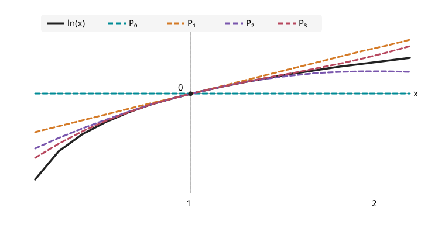
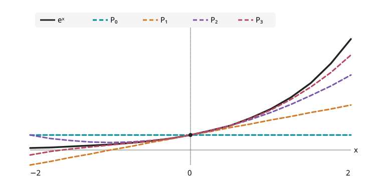
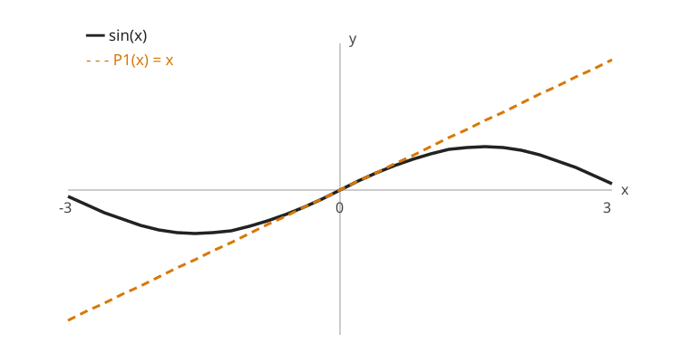
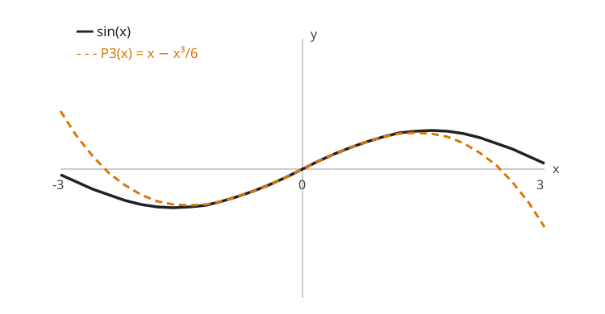
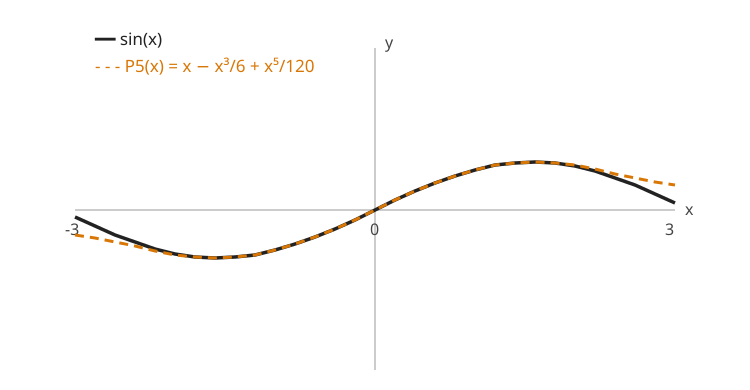
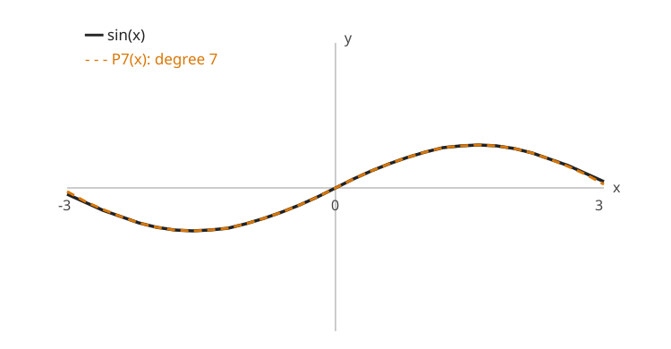
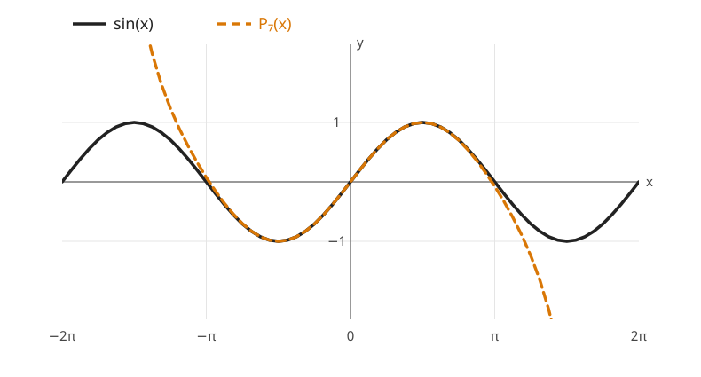

## Taylor Series

By the end of this lesson, you should be able to:

1. Explain how Taylor series coefficients are determined from derivatives of a function.
2. Construct Taylor and Maclaurin polynomials and series.
3. Find Maclaurin series for $e^x$, $\sin x$, and $\cos x$.
4. Use Taylor polynomials to approximate function values.
5. Use Taylor's theorem with remainder to estimate approximation error.
6. Determine when a Taylor series represents its function.

---

## Review: Power Series

Recall that a **power series centered at $a$** has the form

$$
\sum_{n=0}^{\infty}c_n(x-a)^n =c_0+c_1(x-a)+c_2(x-a)^2+\cdots
$$

- The numbers $c_n$ are the coefficients.
- The number $a$ is the center.
- The series converges for values of $x$ within its radius of convergence.

**Given a function how can we find the power series?**

---

## Representing Functions as Power Series

In Section 6.2, we used geometric series to construct power series representations.

For example,

$$
\frac{1}{1-x}
=
\sum_{n=0}^{\infty}x^n,
\qquad |x|<1.
$$

We also constructed new representations using algebra, differentiation, and integration.

**Today we want to find a more general way to find power series.**

---

## The Idea Behind Taylor Series

Suppose a function $f(x)$ can be represented by a power series centered at $a$:

$$
f(x)=c_0+c_1(x-a)+c_2(x-a)^2+\cdots
$$

How can we determine the coefficients $c_n$?

What's $c_0$?  Plug in $x=a$.

$$
f(a)=c_0
$$

---

## Keep Going

What's $c_1$?

Differentiate :

$$
f'(x)=c_1+2c_2(x-a)+3c_3(x-a)^2+\cdots
$$

Plug in $x=a$

$$
f'(a)=c_1
$$

---

## One more

What's $c_2$?

Differentiate :

$$
f''(x)=2c_2+3 \cdot 2 c_3(x-a)+\cdots
$$

Plug in $x=a$ to ger $f''(a)=2c_1$. So
$$
c_2=\frac{f''(a)}{2}
$$

---

## Finding the Coefficients

Continue differentiating and evaluating at $x=a$:

$$
\begin{aligned}
c_0 &= f(a)\\[6pt]
c_1 &= f'(a)\\[6pt]
c_2 &= \frac{f''(a)}{2!}\\[6pt]
c_3 &= \frac{f'''(a)}{3!}
\end{aligned}
$$

## What's the Pattern

In general,

$$
c_n=\frac{f^{(n)}(a)}{n!}
$$

This gives us a formula for the coefficients of a power series representation.

---

## Definition: Taylor Series

The **Taylor series** for a function $f(x)$ centered at $a$ is

$$
\sum_{n=0}^{\infty}
\frac{f^{(n)}(a)}{n!}(x-a)^n
$$

Expanding the first few terms:

$$
\begin{aligned}
f(x)\sim {}&f(a)+f'(a)(x-a)+\frac{f''(a)}{2!}(x-a)^2\\
&+\frac{f'''(a)}{3!}(x-a)^3+\cdots
\end{aligned}
$$

The symbol $\sim$ indicates the formal Taylor expansion. Equality requires that the series converge to $f(x)$.

---

## Definition: Maclaurin Series

A **Maclaurin series** is a Taylor series centered at $a=0$.

$$
\sum_{n=0}^{\infty}
\frac{f^{(n)}(0)}{n!}x^n
$$

In expanded form:

$$
\begin{aligned}
f(x)\sim {}& f(0)+f'(0)x +\frac{f''(0)}{2!}x^2\\
&+\frac{f'''(0)}{3!}x^3+\cdots
\end{aligned}
$$

---

## Taylor Polynomials

A **Taylor polynomial** is a finite partial sum of a Taylor series.

The Taylor polynomial of degree $n$ centered at $a$ is

$$
P_n(x)=
\sum_{k=0}^{n}
\frac{f^{(k)}(a)}{k!}(x-a)^k
$$

## Taylor Polynomials

$$
P_0(x)=f(a)
$$

$$
P_1(x)=f(a)+f'(a)(x-a)
$$

$$
P_2(x)=f(a)+f'(a)(x-a)+\frac{f''(a)}{2}(x-a)^2
$$

Each polynomial gives an approximation to $f(x)$ near $a$.

---

## Taylor Polynomials as Approximations

Recall the linear approximation from Calculus I:

$$
L(x)=f(a)+f'(a)(x-a).
$$

This is precisely the first Taylor polynomial $P_1(x)$. Adding more terms gives higher-degree polynomial approximations. Higher-degree polynomials often provide better approximations near the center.

---

## Example 1: Taylor Polynomials

Consider

$$
f(x)=\ln x.
$$

Find the Taylor polynomials $P_0$, $P_1$, $P_2$, and $P_3$ centered at $a=1$.

---

## Example 1: Taylor Polynomial Approximations

Consider $f(x)=\ln x$ centered at $a=1$.

{width=90% fig-align="center"}

Notice that higher-degree Taylor polynomials provide
better approximations near $x=1$.

---

## Example 1: Taylor Polynomial Approximations {.smaller}

For $f(x)=\ln x$ centered at $a=1$, compare the values of the
Taylor polynomials with the actual function values.

| $x$ | $\ln x$ | $P_0(x)$ | $P_1(x)$ | $P_2(x)$ | $P_3(x)$ |
|:---:|---:|---:|---:|---:|---:|
| 0.5 | -0.6931 | 0.0000 | -0.5000 | -0.6250 | -0.6667 |
| 0.8 | -0.2231 | 0.0000 | -0.2000 | -0.2200 | -0.2227 |
| 0.9 | -0.1054 | 0.0000 | -0.1000 | -0.1050 | -0.1053 |
| 1.0 | 0.0000 | 0.0000 | 0.0000 | 0.0000 | 0.0000 |
| 1.1 | 0.0953 | 0.0000 | 0.1000 | 0.0950 | 0.0953 |
| 1.2 | 0.1823 | 0.0000 | 0.2000 | 0.1800 | 0.1827 |
| 1.5 | 0.4055 | 0.0000 | 0.5000 | 0.3750 | 0.4167 |

Higher-degree Taylor polynomials generally
provide better approximations near $a=1$.

## Example 2: Maclaurin Polynomials

Find the Maclaurin polynomials $P_0$, $P_1$, $P_2$, and $P_3$ for

$$
f(x)=e^x.
$$

---

## Taylor Polynomials as Approximations

Consider $f(x)=e^x$ centered at $a=0$.

## Taylor Polynomials as Approximations

Consider $f(x)=e^x$ centered at $a=0$.

{width=90% fig-align="center"}

---

## The Maclaurin Series for $e^x$

For

$$
f(x)=e^x,
$$

every derivative is $e^x$, so

$$
f^{(n)}(0)=1.
$$

Therefore,

$$
e^x=\sum_{n=0}^{\infty}\frac{x^n}{n!}
$$

or

$$
e^x=1+x+\frac{x^2}{2!}
+\frac{x^3}{3!}+\cdots
$$

This series converges to $e^x$ for all real $x$.

**Radius of convergence:** $R=\infty$.

---

## Example 1: Maclaurin Polynomial Approximations 
For $f(x)=e^x$ centered at $a=0$, compare the values of the
Maclaurin polynomials with the actual function values.

The Maclaurin polynomials are:

- $P_0(x)=1$
- $P_1(x)=1+x$
- $P_2(x)=1+x+\frac{x^2}{2}$
- $P_3(x)=1+x+\frac{x^2}{2}+\frac{x^3}{6}$

---

## Example 1: Maclaurin Polynomial Approximations {.smaller}

| $x$ | $e^x$ | $P_0(x)$ | $P_1(x)$ | $P_2(x)$ | $P_3(x)$ |
|:---:|---:|---:|---:|---:|---:|
| -1.0 | 0.3679 | 1.0000 | 0.0000 | 0.5000 | 0.3333 |
| -0.5 | 0.6065 | 1.0000 | 0.5000 | 0.6250 | 0.6042 |
| -0.2 | 0.8187 | 1.0000 | 0.8000 | 0.8200 | 0.8187 |
| 0.0 | 1.0000 | 1.0000 | 1.0000 | 1.0000 | 1.0000 |
| 0.2 | 1.2214 | 1.0000 | 1.2000 | 1.2200 | 1.2213 |
| 0.5 | 1.6487 | 1.0000 | 1.5000 | 1.6250 | 1.6458 |
| 1.0 | 2.7183 | 1.0000 | 2.0000 | 2.5000 | 2.6667 |

Higher-degree Maclaurin polynomials generally
provide better approximations near $a=0$.

---

## Example 3: Maclaurin Series for Sine

Find the Maclaurin series for

$$
f(x)=\sin x.
$$

. . . 

$$
\sin x=x-\frac{x^3}{3!}
+\frac{x^5}{5!}-\cdots
$$

---

## Maclaurin Polynomial Approximations: $P_1$

Consider $f(x)=\sin x$ centered at $a=0$.

$P_1(x)=x$

{width=82% fig-align="center"}

The linear approximation agrees with $\sin x$ near $x=0$.

---

## Maclaurin Polynomial Approximations: $P_3$

Add the cubic term:

$P_3(x)=x-\frac{x^3}{3!}$

{width=82% fig-align="center"}

The cubic polynomial follows $\sin x$ more closely.

---

## Maclaurin Polynomial Approximations: $P_5$

Add the fifth-degree term:

$P_5(x)=x-\frac{x^3}{3!}+\frac{x^5}{5!}$

{width=82% fig-align="center"}

The approximation improves over a larger interval.

---

## Maclaurin Polynomial Approximations: $P_7$

Add the seventh-degree term:

$P_7(x)=x-\frac{x^3}{3!}+\frac{x^5}{5!}-\frac{x^7}{7!}$

{width=82% fig-align="center"}

The curves are nearly indistinguishable on this interval.

---

## Limitations of Taylor Polynomial Approximations

{width=90% fig-align="center"}

---

## Example 4: Maclaurin Series for Cosine

Find the Maclaurin series for

$$
f(x)=\cos x.
$$

. . . 
$$
\cos x=
1-\frac{x^2}{2!}
+\frac{x^4}{4!}
-\frac{x^6}{6!}+\cdots
$$

---

## Important Maclaurin Series

The following series are especially useful:

**Exponential:** $e^x=\sum_{n=0}^{\infty}\frac{x^n}{n!}$

**Sine:** $\sin x=\sum_{n=0}^{\infty}\frac{(-1)^n x^{2n+1}}{(2n+1)!}$

**Cosine:** $\cos x=\sum_{n=0}^{\infty}\frac{(-1)^n x^{2n}}{(2n)!}$

All three series converge for every real number $x$.

---

## Approximating Function Values

Suppose we want to approximate

$$
e^{0.2}.
$$

We could use the third Maclaurin polynomial:

$$
P_3(x)=1+x+\frac{x^2}{2!}+\frac{x^3}{3!}.
$$

Then $e^{0.2}\approx P_3(0.2)$.

How good is this estimation? How can we estimate the error without knowing the exact value?

---

## The Remainder of a Taylor Polynomial

A Taylor polynomial approximates a function: $f(x)\approx P_n(x)$.

$$
f(x)=P_n(x)+R_n(x).
$$

The **remainder** is the difference between the function and the polynomial:

$$
R_n(x)=f(x)-P_n(x)
$$

The error is $|R_n(x)|$.

We can estimate this error?

---

## Taylor's Theorem with Remainder

Suppose $f$ has at least $n+1$ continuous derivatives on an interval containing $a$ and $x$.

Then there exists a number $c$ between $a$ and $x$ such that

$$
R_n(x)=
\frac{f^{(n+1)}(c)}{(n+1)!}
(x-a)^{n+1}
$$

The number $c$ is generally unknown.

We use a bound on the derivative to estimate the remainder.

---

## Bounding the Approximation Error

Suppose

$$
|f^{(n+1)}(t)|\leq M
$$

for all $t$ between $a$ and $x$.

Then Taylor's theorem tells us

$$
|R_n(x)|
\leq
\frac{M}{(n+1)!}|x-a|^{n+1}
$$

---

## Example 5: Estimating Error

Use the third Maclaurin polynomial for $e^x$, $P_n(x)=1+x+\frac{x^2}{2}+\frac{x^3}{6}$

to approximate $e^{0.2}$.

Use Taylor's theorem to find an upper bound for the error.

**Questions:**

1. What is the fourth derivative of $e^x$? e^x
2. What is its maximum value on $[0,0.2]$?  .2
3. What error bound does Taylor's theorem give?

---

## Example 6: Choosing a Polynomial Degree

We want to approximate $\sin(0.5)$ with an error less than $10^{-5}$.

Use a Maclaurin polynomial and Taylor's theorem to determine a degree that guarantees the required accuracy.

**Questions:**

1. How can we bound the derivatives of $\sin x$?
2. How does the error bound depend on $n$?
3. What degree is sufficient?

---

## Convergence of Taylor Series

A Taylor series for $f(x)$ centered at $a$ is

$$
\sum_{n=0}^{\infty}
\frac{f^{(n)}(a)}{n!}(x-a)^n.
$$

Its partial sums are the Taylor polynomials $P_n(x)$.

For the Taylor series to converge to $f(x)$, we need

$$
\lim_{n\to\infty}P_n(x)=f(x).
$$

Equivalently,

$$
\boxed{
\lim_{n\to\infty}R_n(x)=0.
}
$$

This is the key condition for a Taylor series to represent its function.

---

## Does Every Taylor Series Equal Its Function?

A function may have derivatives of every order at a point.

This allows us to construct its Taylor series.

However, the Taylor series does not necessarily converge to the original function.

**Important distinction:**

- The Taylor formula determines the coefficients.
- The Ratio Test can help determine where the resulting series converges.
- The remainder determines whether the series converges to the original function.

We must distinguish convergence of a series from convergence to the intended function.

---

## Example 7: A Taylor Series Centered at 1

Find the Taylor series for

$$
f(x)=\frac{1}{x}
$$

centered at $a=1$.

Determine its interval of convergence.

**Strategy:**

1. Compute $f^{(n)}(x)$.
2. Evaluate at $x=1$.
3. Find a general formula for the coefficients.
4. Write the Taylor series.
5. Determine its radius and interval of convergence.

---

## Activity: Taylor Series Investigation

Consider the function

$$
f(x)=\cos x.
$$

**Part A:** Find the Maclaurin polynomials

$$
P_2(x),\qquad P_4(x),\qquad P_6(x).
$$

**Part B:** Use each polynomial to approximate

$$
\cos(0.5).
$$

**Part C:** Compare the approximations.

**Discussion:** Why do higher-degree Taylor polynomials tend to give better approximations near the center?

---

## Summary: Taylor and Maclaurin Series

The Taylor series centered at $a$ is

$$
\boxed{
\sum_{n=0}^{\infty}
\frac{f^{(n)}(a)}{n!}(x-a)^n
}
$$

A Maclaurin series is a Taylor series with $a=0$.

Taylor polynomials give finite approximations:

$$
f(x)\approx P_n(x).
$$

Taylor's theorem provides an error bound:

$$
|R_n(x)|
\leq
\frac{M|x-a|^{n+1}}{(n+1)!}.
$$

To prove the series represents $f$, show that $R_n(x)\to0$.

---

## Exit Ticket

1. Find the third-degree Maclaurin polynomial for

   $$
   f(x)=e^{-x}.
   $$

2. Use your polynomial to approximate

   $$
   e^{-0.1}.
   $$

3. Write an expression that bounds the error using Taylor's theorem.

4. Explain the difference between a Taylor polynomial and a Taylor series.

---

## Power Series Can Describe Unknown Functions

So far, we have used Taylor and Maclaurin series to represent familiar functions such as $e^x$, $\sin x$, and $\ln(1+x)$.

But what if we encounter a function that we do not already know?

- Some functions are defined by equations involving their derivatives.
- These equations are called **differential equations**.
- Power series can help us construct solutions even when no familiar formula exists.

**Key Idea:** A power series can define a new function, not just approximate a familiar one.

## Example: The Airy Equation

Consider the differential equation

$$
y''-xy=0.
$$

This is called the **Airy equation**.

We want to find a function $y(x)$ whose second derivative satisfies

$$
y''=xy.
$$

Unlike the differential equation $y'=y$, whose solutions include $e^x$, the Airy equation has no nonzero solutions expressible using elementary functions.

**Question:** Can we describe its solutions using power series?

## Solving the Airy Equation with Power Series

Suppose the unknown function has a Maclaurin series

$$
y(x)=\sum_{n=0}^{\infty}a_nx^n.
$$

Differentiating twice gives

$$
y''(x)=\sum_{n=2}^{\infty}n(n-1)a_nx^{n-2}.
$$

Substitute into $y''-xy=0$:

$$
\sum_{n=2}^{\infty}n(n-1)a_nx^{n-2}
-\sum_{n=0}^{\infty}a_nx^{n+1}=0.
$$

Matching coefficients of equal powers of $x$ gives

- $a_2=0$
- $a_{n+2}=\dfrac{a_{n-1}}{(n+2)(n+1)}$, for $n\geq 1$.

The differential equation tells us how to calculate the coefficients!

## Constructing an Unknown Function

The recurrence relation gives

- $a_2=0$
- $a_3=\dfrac{a_0}{6}$
- $a_4=\dfrac{a_1}{12}$
- $a_5=0$
- $a_6=\dfrac{a_0}{180}$
- $a_7=\dfrac{a_1}{504}$

Therefore, the solution begins as

$$
y(x)=a_0\left(1+\frac{x^3}{6}+\frac{x^6}{180}+\cdots\right)
+a_1\left(x+\frac{x^4}{12}+\frac{x^7}{504}+\cdots\right).
$$

The constants $a_0=y(0)$ and $a_1=y'(0)$ determine a particular solution.

**Notice:** We have constructed a function without knowing an elementary formula for it!

## Why This Matters

The Airy equation has two important solutions called the **Airy functions**, $\operatorname{Ai}(x)$ and $\operatorname{Bi}(x)$.

These functions appear in applications involving wave motion, optics, and quantum mechanics.

- Power series provide a way to define and calculate these functions.
- Adding more terms gives increasingly accurate approximations.
- The series solutions converge for every real number $x$.

Taylor and Maclaurin series do more than approximate known functions. They allow us understand new functions.
